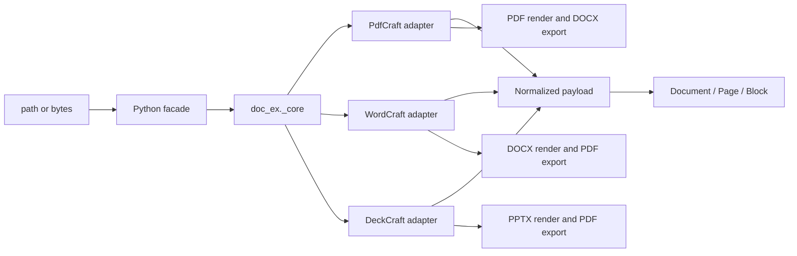

# Design: Rust document engine

## Summary

`doc-ex` is a mixed Python/Rust package licensed under Apache-2.0. Python retains the stable PyMuPDF-style API and Markdown rendering. A private PyO3 extension, `doc_ex._core`, adapts pinned upstream ArtCraft engine crates from PdfCraft, WordCraft, and DeckCraft. No desktop UI, CLI, MCP, networking, updater, or subprocess component is linked.



## Dependency policy

Every upstream repository is pinned to an immutable release commit:

- PdfCraft v0.9.0: `645016addcfb9078c557f0189559ab47cdcee057`
- WordCraft v0.8.0: `f2e15cf8f899a79899a2d9595ca4ce7df1e5ea22`
- DeckCraft v0.8.0: `22db9261f9d1a214c296fd390173130c45d76d66`
- Craft PDF backend patches use the immutable `craft-libs` revision required by WordCraft/DeckCraft.

Cargo features separate extraction from rendering and conversion. Only operation-specific crates are linked. A locked license audit must permit Apache-2.0, MIT, BSD, ISC, Zlib, Unicode, and similarly permissive licenses; GPL, AGPL, and LGPL-only dependencies are rejected.

## Native adapters

### PdfCraft

`pdfcraft-render`, `pdfcraft-cos`, `pdfcraft-edit`, and `pdfcraft-create` open PDF bytes and expose page metadata, positioned reading-order text, links, and images. PDF→DOCX maps those public values into `pdfcraft-export::Page` and calls `pdfcraft-export::docx`, preserving the upstream conversion implementation without linking the application engine, JavaScript, automation, printing, or UI crates.

### WordCraft

`wordcraft-docx::read_with_password` returns the public `wordcraft_doc::Document`. The adapter recursively walks ordered `Block::Para` and `Block::Table` values, resolves inherited heading levels, run hyperlinks, inline images, comments, and explicit page breaks. `wordcraft-layout` supplies computed pages and `wordcraft-render` supplies page images. DOCX→PDF uses `wordcraft-pdf`, and upstream Markdown may be used for fidelity checks.

### DeckCraft

`deckcraft-pptx::import` returns the public presentation model. The adapter recursively walks grouped shapes, text paragraphs/runs, hyperlinks, tables, notes, comments, and media. `deckcraft-render` renders slides and `deckcraft-pdf` exports PDF.

## Python boundary

```python
_core.extract(data: bytes, filetype: str, password: str | None) -> str
_core.convert(data: bytes, source_format: str, target_format: str, password: str | None) -> bytes
_core.render(data: bytes, filetype: str, page: int, dpi: float, password: str | None) -> bytes
```

JSON remains the narrow extraction ABI. Images are base64 encoded only across this boundary. `render` returns PNG bytes. Python hydrates typed `Document`, `Page`, `Block`, `Table`, `Link`, and `Image` values.

## Conversion matrix

| Source | Target | Upstream implementation |
|---|---|---|
| PDF | DOCX | PdfCraft engine Office export |
| DOCX | PDF | WordCraft PDF export |
| PPTX | PDF | DeckCraft PDF export |

Other pairs fail explicitly. Conversion fidelity and warnings are those of the pinned upstream release.

## Rendering

`Page.get_pixmap(dpi=144)` and `Document.render_page(page, dpi=144)` return PNG bytes. PDF uses PdfCraft rendering, DOCX uses WordCraft layout/render, and PPTX uses DeckCraft rendering. Rendering is feature-gated so extraction-only wheels can be evaluated separately if footprint becomes excessive.

## Normalized model

The normalized payload preserves zero-based pages, ordered blocks, links, images, tables, comments/notes, optional geometry, and format-specific metadata. Markdown remains in Python. PDF tables use upstream Office-export inference for conversion; extraction exposes conservative table candidates derived from public glyph geometry because PdfCraft v0.9.0 does not publish its detector.

## Safety and errors

Upstream bounded parsers handle object/package limits and malformed content. The adapter applies additional input-byte and output-image limits before allocating Python payloads. No native adapter performs network access. Upstream errors are mapped to stable categories: unsupported, malformed, encrypted, resource limit, and conversion failure.

## Testing

Tests use generated fixtures and upstream project fixtures where licensing permits. They cover extraction structure, links, media, tables, comments/notes, rendering signatures, conversion reopen, malformed input, close semantics, and Python error mapping. Release validation runs formatting, tests, Clippy, a locked license audit, wheel build/install, footprint measurement, and a scan proving no direct parser or external CLI path remains.
