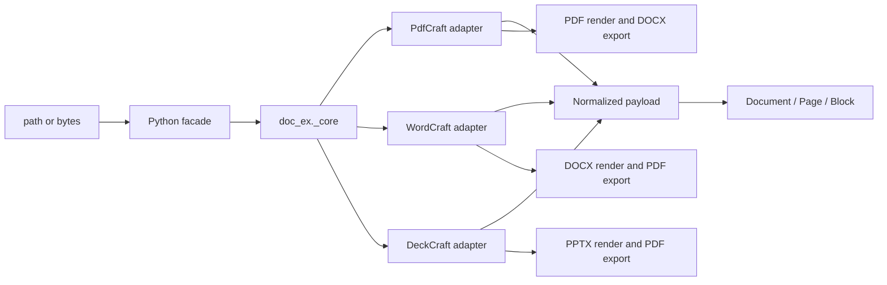

# Design: Rust document engine

## Summary

`pydoccraft` is a mixed Python/Rust package licensed under Apache-2.0. Python retains the stable PyMuPDF-style `doc_ex` API and Markdown rendering. A private PyO3 extension, `doc_ex._core`, adapts pinned upstream ArtCraft engine crates from PdfCraft, WordCraft, and DeckCraft. No desktop UI, CLI, MCP, networking, updater, or subprocess component is linked.



## Dependency policy

Every upstream repository is pinned to an immutable release commit:

- PdfCraft v0.9.0: `645016addcfb9078c557f0189559ab47cdcee057`
- WordCraft v0.8.0: `f2e15cf8f899a79899a2d9595ca4ce7df1e5ea22`
- DeckCraft v0.8.0: `22db9261f9d1a214c296fd390173130c45d76d66`
- Craft PDF backend patches use the immutable `craft-libs` revision required by WordCraft/DeckCraft.

Rendering and conversion dependencies are currently unconditional in the release wheel; only operation-specific upstream crates are linked, and no application umbrella crate is used. A locked license audit must permit Apache-2.0, MIT, BSD, ISC, Zlib, Unicode, and similarly permissive licenses; GPL, AGPL, and LGPL-only dependencies are rejected.

## Native adapters

### PdfCraft

`pdfcraft-render`, `pdfcraft-cos`, `pdfcraft-edit`, and `pdfcraft-create` open PDF bytes and expose page metadata, positioned reading-order text, links, and images. PDF→DOCX maps those public values into `pdfcraft-export::Page` and calls `pdfcraft-export::docx`, preserving the upstream conversion implementation without linking the application engine, JavaScript, automation, printing, or UI crates.

### WordCraft

`wordcraft-docx::read_with_password` returns the public `wordcraft_doc::Document`. The adapter recursively walks ordered `Block::Para` and `Block::Table` values, resolves inherited heading levels, run hyperlinks, inline images, comments, and explicit page breaks. `wordcraft-layout` supplies computed pages and `wordcraft-render` supplies page images. DOCX→PDF uses `wordcraft-pdf`, and upstream Markdown may be used for fidelity checks.

### DeckCraft

`deckcraft-pptx::import` returns the public presentation model. The adapter recursively walks grouped shapes, text paragraphs/runs, hyperlinks, tables, notes, comments, and media. `deckcraft-render` renders slides and `deckcraft-pdf` exports PDF.

## Python boundary

```python
_core.extract(data: bytes, filetype: str, password: str | None) -> str
_core.convert(data: bytes, source_format: str, target_format: str, password: str | None) -> bytes
_core.render(data: bytes, filetype: str, page: int, dpi: float, password: str | None) -> bytes
```

JSON remains the narrow extraction ABI. Images are base64 encoded only across this boundary. `render` returns PNG bytes. Python hydrates typed `Document`, `Page`, `Block`, `Table`, `Cell`, `Link`, and `Image` values.

## Conversion matrix

| Source | Target | Upstream implementation |
|---|---|---|
| PDF | DOCX | PdfCraft public extraction values mapped into the `pdfcraft-export` DOCX writer |
| DOCX | PDF | WordCraft PDF export |
| PPTX | PDF | DeckCraft PDF export |

Other pairs fail explicitly. Conversion fidelity and warnings are those of the pinned upstream release.

## Rendering

`Page.get_pixmap(dpi=144)` and `Document.render_page(page, dpi=144)` return PNG bytes. PDF uses PdfCraft rendering, DOCX uses WordCraft layout/render, and PPTX uses DeckCraft rendering. These dependencies are included unconditionally in the current wheel; extraction-only feature builds are not implemented.

A private `rendering` helper validates finite DPI, raster dimensions and RGBA length. PDF/DOCX encoding unpremultiplies color channels and writes PNG physical resolution; PPTX retains upstream `to_png_at`. The shared raster budget is 64 million pixels. WordCraft/DeckCraft dimensions are preflighted before raster allocation; PdfCraft already enforces the matching pixel budget with `reject_oversize`. DeckCraft's caught-panic blank-image behavior remains U09; local code cannot reliably distinguish that output from an intentional blank slide.

## Normalized model

The normalized payload preserves zero-based pages, ordered blocks, links, images, tables, comments/notes, optional geometry, and format-specific metadata. Markdown remains in Python. PDF tables use upstream Office-export inference for conversion; extraction exposes conservative table candidates derived from public glyph geometry because PdfCraft v0.9.0 does not publish its detector.

DOCX `TablePayload.cells` recursively owns `CellPayload.blocks`, spans and vertical merge state. The existing flat `rows` stays compatible. Python renders nested/merged/rich cells as escaped HTML tables inside Markdown and suppresses already-emitted cell assets in the page appendix. Empty cell structure is omitted from serialized PDF/PPTX tables. This schema is extraction output, not a replacement authoring document model.

## Safety and errors

Upstream bounded parsers handle object/package limits and malformed content. The adapter adds OOXML archive preflight limits and validates render DPI and output dimensions; whole-input, aggregate image-byte, normalized JSON-size, and total execution-time limits remain the caller's responsibility. No native adapter performs network access. Upstream errors are mapped to stable categories: unsupported, malformed, encrypted, resource limit, and conversion failure.

## Testing

Tests use generated fixtures and upstream project fixtures where licensing permits. They cover extraction structure, links, media, tables, comments/notes, multi-DPI dimensions/metadata/visible output, conversion reopen, malformed input, close semantics, and Python error mapping. `tools/validate_installed.py` compares imported package files with the wheel before running the corpus and writes machine-readable evidence. Release validation runs formatting, tests, Clippy, a locked license audit, wheel build/install, footprint measurement, and a scan proving no direct parser or external CLI path remains.

## Planned extensions

The [feature roadmap](../../../TODO.md) distinguishes existing rendering from pending DPI validation/metadata work and new authoring work. No creation or save API is currently exposed. Proposed DOCX authoring must adapt WordCraft's public model/writer; PDF authoring must adapt PdfCraft's public creation APIs. Verify these APIs at the pinned revisions before defining the Python builder and a narrow native creation boundary. Do not serialize formats in Python or expose upstream Rust types.

Structured reports may reuse DOCX creation followed by the existing WordCraft PDF exporter. Preserve the current extraction model and bytes-returning render/conversion contracts. Source locators, recursive table content, and diagnostics should be additive, with explicit limitations when upstream lacks exact geometry or semantics. These are design directions for the backlog, not implemented behavior.

### Python authoring facade

The [authoring API proposal](../../../docs/authoring-api-design.md) defines a Pillow-like direction: a simple factory, typed editable objects, named properties, explicit units, independent copying and explicit saving. Microsoft Open XML SDK supplies feature coverage references only. The API belongs to pydoccraft and does not expose C# schema classes, engine-specific Rust objects, or raw package editing as the normal user path.

An explicit edit-copy operation must retain the full upstream model from original source bytes; extracted `Page`/`Block`/`Table` values are insufficient to reconstruct arbitrary documents safely. Existing extraction values remain owned snapshots. Editable DOCX sections represent flowing content; PDF pages and PPTX slides retain fixed geometry. Changes invalidate layout/render state consistently, with explicit handle lifetime rules.

New native operations must remain narrow and bounded. Final session/serialization interfaces are deferred to API8 until pinned public upstream APIs are audited. Python performs API validation and explicit path/stream I/O; upstream libraries own mutation, serialization, layout and format-specific algorithms. Unsupported public capabilities require upstream work rather than another backend, handwritten XML/PDF serialization or application crates.

The expanded table/background roadmap distinguishes semantic cells, native document background, anchored drawings/watermarks and raster preview backgrounds. These have different scope and preservation rules. A compatibility ledger must track read/create/edit/preserve/render/export independently; no-op save and unknown-part handling are required before advertising safe editing. Planned tests and upstream blockers are recorded against stable roadmap IDs.

### Overlap review and upstream ownership

The [canonical workstreams](../../../docs/roadmap-workstreams.md) consolidate 139 coverage IDs into 14 ownership units, with an exhaustive JSON mapping. Keep recipes and acceptance scenarios distinct from implementation primitives. Use existing PNG methods, content insertion, ordinary properties, safe copies and ordered collections; no extra rendered-page wrapper, report builder, template language, batch API or public session framework is planned.

The [upstream register](../../../docs/upstream-roadmap.md) records a pinned-source audit. WordCraft and DeckCraft writers and numerous editing/background primitives already exist. Confirmed focused candidates include a public PdfCraft table detector, a fallible DeckCraft render path instead of blank-image fallback, and lower-level WordCraft revision-resolution routines currently located in engine code. Public availability, current integration and verified fidelity are separate states. Missing format algorithms belong upstream; adapter code must not duplicate them or link prohibited engines.

## Native authoring profile (unreleased)

`src/doc_ex/_authoring.py` owns Python object identity, units/colors, ordered collections and explicit filesystem persistence. `author_docx.rs`, `author_pdf.rs` and `author_pptx.rs` own private PyO3 native document models. These private types serialize bytes through the selected upstream writers; no upstream type crosses the Python boundary. Existing `_core.extract`, `_core.render` and `_core.convert` remain compatible.

Document creation uses WordCraft `Document`, PdfCraft COS/create/edit/organize, and DeckCraft's blank model/public PPTX writer. Native mutation operates on owned models and validates compound changes before committing. DOCX revision-bound ranges use Unicode character offsets and checked story/path locators. PPTX handles resolve stable native slide and shape IDs after slide reordering. PDF page/annotation handles are invalidated after structural changes when indexes can move. Cached Python extraction snapshots are invalidated on mutation.

Existing PDF `Document.edit()` passes original source bytes to the conservative native edit profile. Office source editing is refused until unsupported package content can be diagnosed. This avoids reconstructing editable documents from incomplete extraction snapshots. New authored Office models are editable throughout their owned lifetime.

`save(path)` serializes first, writes a same-directory temporary file, preserves an existing mode and replaces atomically; native code does not write caller paths. Stream writes report incomplete writes without claiming rollback. Scope and format limitations are published in `docs/authoring.md`. Header/footer authoring and rendering do not imply those stories are yet emitted by the DOCX extraction adapter.

## DOCX story projection and layout controls

The native extraction payload adds optional `stories` containing `StoryPayload { kind, blocks, metadata }`. Python hydrates the same owned `Block`, `Table`, `Cell`, `Link` and `Image` hierarchy and exposes `Document.stories`. This separates source stories from computed pages; parts are not duplicated for each rendered occurrence. `Story.get_text` reuses existing page formatting without inventing a page locator. Native part-ID ordering, legacy comment projection and note references are explicit metadata.

Table/paragraph layout setters remain on the same native editable owner. Column widths validate the containing page/cell and nested content; row controls use the native row properties, and uniform borders respect writer precision. Explicit page breaks use native paragraph properties. No custom pagination engine or Python table-layout algorithm is introduced.
