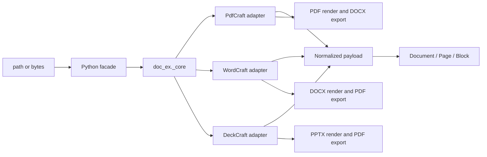

# Design: Rust document engine

## Summary

`pydoccraft` is a mixed Python/Rust package licensed under Apache-2.0. Python retains the stable PyMuPDF-style `doc_ex` API and Markdown rendering. A private PyO3 extension, `doc_ex._core`, adapts pinned upstream ArtCraft engine crates from PdfCraft, WordCraft, and DeckCraft. No desktop UI, CLI, MCP, networking, updater, or subprocess component is linked.



## Dependency policy

Every upstream repository is pinned to an immutable release commit:

- PdfCraft v0.9.0: `645016addcfb9078c557f0189559ab47cdcee057`
- WordCraft v0.8.0: `f2e15cf8f899a79899a2d9595ca4ce7df1e5ea22`
- DeckCraft v0.8.0: `22db9261f9d1a214c296fd390173130c45d76d66`
- Craft PDF backend patches use the immutable `craft-libs` revision required by WordCraft/DeckCraft.

Rendering and conversion dependencies are currently unconditional in the release wheel; only operation-specific upstream crates are linked, and no application umbrella crate is used. A locked license audit must permit Apache-2.0, MIT, BSD, ISC, Zlib, Unicode, and similarly permissive licenses; GPL, AGPL, and LGPL-only dependencies are rejected.

## Native adapters

### PdfCraft

`pdfcraft-render`, `pdfcraft-cos`, `pdfcraft-edit`, and `pdfcraft-create` open PDF bytes and expose page metadata, positioned reading-order text, links, and images. PDF→DOCX maps those public values into `pdfcraft-export::Page` and calls `pdfcraft-export::docx`, preserving the upstream conversion implementation without linking the application engine, JavaScript, automation, printing, or UI crates.

### WordCraft

`wordcraft-docx::read_with_password` returns the public `wordcraft_doc::Document`. The adapter recursively walks ordered `Block::Para` and `Block::Table` values, resolves inherited heading levels, run hyperlinks, inline images, comments, and explicit page breaks. `wordcraft-layout` supplies computed pages and `wordcraft-render` supplies page images. DOCX→PDF uses `wordcraft-pdf`, and upstream Markdown may be used for fidelity checks.

### DeckCraft

`deckcraft-pptx::import` returns the public presentation model. The adapter recursively walks grouped shapes, text paragraphs/runs, hyperlinks, tables, notes, comments, and media. `deckcraft-render` renders slides and `deckcraft-pdf` exports PDF.

## Python boundary

```python
_core.extract(data: bytes, filetype: str, password: str | None) -> str
_core.extract_text(data: bytes, pages: list[int] | None, password: str | None) -> str
_core.convert(data: bytes, source_format: str, target_format: str, password: str | None) -> bytes
_core.render(data: bytes, filetype: str, page: int, dpi: float, password: str | None) -> bytes
```

JSON remains the narrow structured-extraction ABI. Images are base64 encoded only across this boundary. The additive PDF `extract_text` fast path returns bounded form-feed-separated text directly and deliberately omits structured values; DOCX/PPTX use the existing eager model fallback in Python. `render` returns PNG bytes. Python hydrates typed `Document`, `Page`, `Block`, `Table`, `Cell`, `Link`, and `Image` values.

## Conversion matrix

| Source | Target | Upstream implementation |
|---|---|---|
| PDF | DOCX | PdfCraft public extraction values mapped into the `pdfcraft-export` DOCX writer |
| DOCX | PDF | WordCraft PDF export |
| PPTX | PDF | DeckCraft PDF export |

Other pairs fail explicitly. Conversion fidelity and warnings are those of the pinned upstream release.

## Rendering

`Page.get_pixmap(dpi=144)` and `Document.render_page(page, dpi=144)` return PNG bytes. PDF uses PdfCraft rendering, DOCX uses WordCraft layout/render, and PPTX uses DeckCraft rendering. PDF eager open privately retains the same PdfCraft `PageRenderer` used for text extraction and reuses its parsed document for later renders; `Document.close()` drops that state while hydrated values remain owned. The one-shot `_core.render` boundary remains for non-session routing and compatibility. DOCX layout reuse is still pending. These dependencies are included unconditionally in the current wheel; extraction-only feature builds are not implemented.

A private `rendering` helper validates finite DPI, raster dimensions and RGBA length. PDF/DOCX encoding unpremultiplies color channels and writes PNG physical resolution; PPTX retains upstream `to_png_at`. The shared raster budget is 64 million pixels. WordCraft/DeckCraft dimensions are preflighted before raster allocation; PdfCraft already enforces the matching pixel budget with `reject_oversize`. DeckCraft's caught-panic blank-image behavior remains U09; local code cannot reliably distinguish that output from an intentional blank slide.

## Normalized model

The normalized payload preserves zero-based pages, ordered blocks, links, images, tables, comments/notes, optional geometry, and format-specific metadata. Markdown remains in Python. PDF tables use upstream Office-export inference for conversion; extraction exposes conservative table candidates derived from public glyph geometry because PdfCraft v0.9.0 does not publish its detector.

DOCX `TablePayload.cells` recursively owns `CellPayload.blocks`, spans and vertical merge state. The existing flat `rows` stays compatible. Python renders nested/merged/rich cells as escaped HTML tables inside Markdown and suppresses already-emitted cell assets in the page appendix. Empty cell structure is omitted from serialized PDF/PPTX tables. This schema is extraction output, not a replacement authoring document model.

## Safety and errors

Upstream bounded parsers handle object/package limits and malformed content. The adapter adds OOXML archive preflight limits and validates render DPI and output dimensions; whole-input, aggregate image-byte, normalized JSON-size, and total execution-time limits remain the caller's responsibility. No native adapter performs network access. Upstream errors are mapped to stable categories: unsupported, malformed, encrypted, resource limit, and conversion failure.

## Testing

Tests use generated fixtures and upstream project fixtures where licensing permits. They cover extraction structure, links, media, tables, comments/notes, multi-DPI dimensions/metadata/visible output, conversion reopen, malformed input, close semantics, and Python error mapping. `tools/validate_installed.py` compares imported package files with the wheel before running the corpus and writes machine-readable evidence. Release validation runs formatting, tests, Clippy, a locked license audit, wheel build/install, footprint measurement, and a scan proving no direct parser or external CLI path remains.

## Planned extensions

The [feature roadmap](../../../TODO.md) distinguishes existing rendering from pending DPI validation/metadata work and new authoring work. Creation and save are now exposed by the initial native authoring profile below. Proposed DOCX authoring must adapt WordCraft's public model/writer; PDF authoring must adapt PdfCraft's public creation APIs. Verify these APIs at the pinned revisions before extending the typed Python facade and narrow native boundary. Do not serialize formats in Python or expose upstream Rust types.

Structured reports may reuse DOCX creation followed by the existing WordCraft PDF exporter. Preserve the current extraction model and bytes-returning render/conversion contracts. Source locators, recursive table content, and diagnostics should be additive, with explicit limitations when upstream lacks exact geometry or semantics. These are design directions for the backlog, not implemented behavior.

### Python authoring facade

The [authoring API proposal](../../../docs/authoring-api-design.md) defines a Pillow-like direction: a simple factory, typed editable objects, named properties, explicit units, independent copying and explicit saving. Microsoft Open XML SDK supplies feature coverage references only. The API belongs to pydoccraft and does not expose C# schema classes, engine-specific Rust objects, or raw package editing as the normal user path.

An explicit edit-copy operation must retain the full upstream model from original source bytes; extracted `Page`/`Block`/`Table` values are insufficient to reconstruct arbitrary documents safely. Existing extraction values remain owned snapshots. Editable DOCX sections represent flowing content; PDF pages and PPTX slides retain fixed geometry. Changes invalidate layout/render state consistently, with explicit handle lifetime rules.

New native operations must remain narrow and bounded. Final session/serialization interfaces are deferred to API8 until pinned public upstream APIs are audited. Python performs API validation and explicit path/stream I/O; upstream libraries own mutation, serialization, layout and format-specific algorithms. Unsupported public capabilities require upstream work rather than another backend, handwritten XML/PDF serialization or application crates.

The expanded table/background roadmap distinguishes semantic cells, native document background, anchored drawings/watermarks and raster preview backgrounds. These have different scope and preservation rules. A compatibility ledger must track read/create/edit/preserve/render/export independently; no-op save and unknown-part handling are required before advertising safe editing. Planned tests and upstream blockers are recorded against stable roadmap IDs.

### Overlap review and upstream ownership

The [canonical workstreams](../../../docs/roadmap-workstreams.md) consolidate 139 coverage IDs into 14 ownership units, with an exhaustive JSON mapping. Keep recipes and acceptance scenarios distinct from implementation primitives. Use existing PNG methods, content insertion, ordinary properties, safe copies and ordered collections; no extra rendered-page wrapper, report builder, template language, batch API or public session framework is planned.

The [upstream register](../../../docs/upstream-roadmap.md) records a pinned-source audit. WordCraft and DeckCraft writers and numerous editing/background primitives already exist. Confirmed focused candidates include a public PdfCraft table detector, a fallible DeckCraft render path instead of blank-image fallback, and lower-level WordCraft revision-resolution routines currently located in engine code. Public availability, current integration and verified fidelity are separate states. Missing format algorithms belong upstream; adapter code must not duplicate them or link prohibited engines.

## Native authoring profile (unreleased)

`src/doc_ex/_authoring.py` owns Python object identity, units/colors, ordered collections and explicit filesystem persistence. `author_docx.rs`, `author_pdf.rs` and `author_pptx.rs` own private PyO3 native document models. These private types serialize bytes through the selected upstream writers; no upstream type crosses the Python boundary. Existing `_core.extract`, `_core.render` and `_core.convert` remain compatible.

Document creation uses WordCraft `Document`, PdfCraft COS/create/edit/organize, and DeckCraft's blank model/public PPTX writer. Native mutation operates on owned models and validates compound changes before committing. DOCX revision-bound ranges use Unicode character offsets and checked story/path locators. PPTX handles resolve stable native slide and shape IDs after slide reordering. PDF page/annotation handles are invalidated after structural changes when indexes can move. Cached Python extraction snapshots are invalidated on mutation.

Existing PDF `Document.edit()` passes original source bytes to the conservative native edit profile. Office source editing is refused until unsupported package content can be diagnosed. This avoids reconstructing editable documents from incomplete extraction snapshots. New authored Office models are editable throughout their owned lifetime.

`save(path)` serializes first, writes a same-directory temporary file, preserves an existing mode and replaces atomically; native code does not write caller paths. Stream writes report incomplete writes without claiming rollback. Scope and format limitations are published in `docs/authoring.md`. Auxiliary header/footer extraction is described below; source editing still requires separate preservation evidence.

## DOCX story projection and layout controls

The native extraction payload adds optional `stories` containing `StoryPayload { kind, blocks, metadata }`. Python hydrates the same owned `Block`, `Table`, `Cell`, `Link` and `Image` hierarchy and exposes `Document.stories`. This separates source stories from computed pages; parts are not duplicated for each rendered occurrence. `Story.get_text` reuses existing page formatting without inventing a page locator. Native part-ID ordering, legacy comment projection and note references are explicit metadata. Reference-only paragraphs retain their anchor blocks. Paragraph normalization walks ordered native formatting ranges and inline objects once, keeps incremental Unicode character counts, and slices link labels at recorded UTF-8 boundaries; it does not repeatedly rescan paragraph prefixes.

Table/paragraph layout setters remain on the same native editable owner. Column widths validate the containing page/cell and nested content; row controls use the native row properties, and uniform borders respect writer precision. Explicit page breaks insert the native page-break marker in a dedicated paragraph; page-break-before remains a separate native paragraph property. No custom pagination engine or Python table-layout algorithm is introduced.

## Text, vectors and diagnostics

DOCX list membership and range links modify public WordCraft model values. Native ranges remain revision-bound Unicode offsets; links reject unsupported schemes and oversized targets. Header/footer getters use a nonmutating part lookup, while insertion creates missing stories atomically. Lists and links share normal paragraphs and ranges; no separate list/document builder is exposed.

PDF font registration, shaping, embedding, vector serialization, metadata and outline operations use pinned public PdfCraft crates. The already-transitive `pdfcraft-content` and `pdfcraft-fonts` crates become direct dependencies without adding graph packages. PDF paths accept a bounded sequence of move/line/curve commands, opaque stroke/fill and native coordinate conversion. Bookmark paths are private, structural edits invalidate unrelated handles, and originating child collections refresh only when their parent identity is unchanged. Supplied fonts remain caller input; the Inter test fixture retains its OFL attribution.

A private bounded diagnostics accumulator groups detectable native constructs by fixed code, count and source examples. DOCX and PPTX extraction populate it while walking existing models; it does not deserialize unknown source markup or create a public capability framework. DOCX text normalization consumes object and formatting iterators monotonically, retaining exact Unicode/UTF-8 link offsets without repeated prefix scans.

Python bounded reads accept bytes, paths and binary streams, preserving caller stream ownership. Native entry points recheck input size; JSON serialization writes to a bounded buffer and accounts for escaped UTF-8 output. Diagnostics and payload budgets constrain adapter output, not every upstream parser allocation. The report example composes existing DOCX methods and conversion with no new runtime abstraction.

## Formatting and portable content projection

A bounded flat scalar patch crosses the private native authoring boundary. WordCraft character/paragraph values and public overlays/resolvers implement direct-property clearing and inheritance; no Rust model is deserialized from caller JSON. Named paragraph/character style handles resolve immutable native IDs, validate the entire affected inheritance graph, and expose direct or resolved property snapshots. Native table context participates in paragraph-spacing resolution. The Python facade uses typed keyword maps and a shared range/collection vocabulary, rather than a public formatting schema or builder framework.

PPTX ranges map flat Unicode offsets (including LF paragraph separators) to public DeckCraft edit positions after strict bounds checks. Native revision counters invalidate incompatible ranges. New links construct only URL or stable SlideId actions; whole-document checks protect reorder/deletion and account for links in tables, notes and grouped shapes. Native split/allocation preflights bound run/property growth before mutations, including existing whole-shape setters. Canonical readable underline names are projected to native tokens inside Rust. Mixed hyperlink reads remain explicit errors, while assignment can replace or clear the range through a private permissive lookup; stale/range checks still run first. Link URLs share native text validation so serialization cannot silently remove invalid XML characters.

Portable Markdown returns `dict[str, bytes]`; the mapping itself is the in-memory package. A private image-reference callback flows through existing page and recursive table formatting. Content hashes deduplicate media independently of placement identity. Generated paths cannot inherit traversal from source filenames; story files use numeric names and relative media references. A preflight walks bounded nodes/depth and estimates escaping growth, then package/manifest serialization checks aggregate encoded bytes. Existing source hyperlinks remain caller-visible data and are not fetched or sanitized.

## Section identity and native grid mutation

DOCX section IDs are append-only ordinals over native section-ending paragraphs. The Python Section retains its ID and routes fixed-shape property patches to that native section. Appending materializes independent part IDs using public native part creation and clone-on-write blocks; shared immutable media stays owned by the document. Missing header/footer references become independent empty parts to avoid implicit previous-section inheritance. Synthetic section markers stay outside ordinary paragraph collections. Existing native writers generate relationships.

PPTX table structural generations are keyed by stable native shape IDs. Shared Python table/row/cell wrappers dispatch using the existing format-specific argument prefix; they do not introduce another table schema. Public native grid functions implement structural edits, while adapter preflight rejects unsupported overlap/size cases and validates resulting budgets. Covered coordinates map to an anchor, the rectangular text view emits content only there, and changed-table generations reject stale positional row/cell handles. Explicit minimum-height/border limitations follow the pinned renderer rather than being emulated locally.

Cell margins/alignment reuse native public properties in both adapters. Direct alignment getters distinguish None inheritance from an explicit setting; resolved margin getters use native defaults. Ordinary letter-template and independent-copy loops live in an example file, leaving template syntax, data formatting and batch policy outside the package API.

## Grid structure and PDF geometry

DOCX now shares the existing Python table grid verbs with PPTX. Native per-table generations protect positional handles; structural edits unregister descendants while stable table IDs and unrelated handles survive. Public WordCraft grid mutations run on staged models with pre/post validation; surviving native block identities retain synthetic cell-placeholder bookkeeping. The adapter rejects orphan vertical-merge continuations instead of copying the missing native anchor-repair algorithm.

PDF page boxes use public organize BoxSpec and PageInfo coordinate transforms. A staged write/inspect refreshes effective geometry and sizes before commit. Python invalidates page-related handles and cached render state; changed-page backgrounds become unknown. RGB color is applied to native content operations, including supplied-font glyph operations. Native ContentTruncated warnings and outline_more inspection flags map to explicit resource-limit failures.

## Native notes and owned PDF fields

DOCX note creation builds a public native PartKind story and inserts a NoteRef at the checked UTF-8 offset derived from the Python character range. Built-in note/reference styles and native section NoteProps supply rendering and numbering. The ordinary story/paragraph facade is reused; native part identities stay private. Generic commit preflight compares semantic marker identities/multiplicities and rejects orphaning or duplication. Whole-document cloning preserves note parts; arbitrary fragment copying remains upstream work. Note body text stays editable; serialization supplies the native own-note mark.

PDF fields use the lower-level pdfcraft-forms crate at the existing PdfCraft revision. Only new owned models and their clones enter bounded field enumeration; imported AcroForms remain rejected. Shared Python field collections filter by page and index by immutable name. Structural field/page generations prevent stale handles from binding to a recreated name. Native mutations clone/stage, enforce a shallow script-free single-widget profile, validate fixed Helvetica appearances with native width metrics and reject undrawn fields/NeedAppearances. Existing native flatten performs removal; postconditions gate commit. Page organization revalidates the profile. No PDF field-tree or appearance serialization is implemented locally.

## Table formatting and outline-aware imports

Count construction expands only a bounded blank string grid before entering existing native constructors. Slice access returns ordinary lists of existing cell handles, avoiding a new collection/view abstraction. Typed formatting dictionaries are bounded before native conversion; table/cell patch handlers stage native property changes and reuse existing grid/content validation. Native layout checks effective available geometry, and public measurement/autofit determines fitted columns. Direct formatting snapshots do not claim resolved conditional styles or complete shared-edge border precedence.

Outline-aware imports add one optional keyword to the existing page insertion method. The adapter preflights source native bookmark snapshots/semantic keys, then calls insert_file_pages with native conflict policy. Source/post-copy snapshots verify count, depth, title/structure and supported destination mapping; the adapter does not serialize or remap outlines itself. Existing page generations invalidate related handles. Default imports and subset copies keep their documented no-outline policy.

## Conditional styles and multiline PDF labels

Table styles extend the existing style kind and formatting dispatch. WordCraft Style table parts and StyleSheet resolution own inheritance and conditional properties. The facade adds one optional region argument and table style/look patch keys, avoiding parallel cell-style or conditional-format builder objects. Native layout supplies one cell-width snapshot for affected-table validation, including ancestor and unregistered nested tables. Explicit margins and changed inherited margins must retain valid content allocation. Table-style snapshots distinguish base-chain resolution from final cell appearance.

PDF links share one bounded native text/provenance index containing normalized text, glyph byte/Unicode offsets and uniquely matched surviving paragraphs. Native line/text APIs determine spaces and newlines. Candidate selected glyphs must be contiguous and uniquely owned; accepted multiline block intervals merge only when they overlap. A single block rebuild joins exact native text and remaps all accepted labels, including adjacent single-line annotations. Failed identity, geometry or substring checks leave labels unresolved. This annotation-driven normalization neither infers columns nor changes plain-text extraction.

## Native region rendering and DOCX tabs/breaks

One optional clip tuple passes through the existing render entry points to `_core.render`. A shared private raster-region helper intersects displayed-page coordinates and snaps outward against the backend's existing scale/pixel extent. PdfCraft tile requests, WordCraft affine region rendering and DeckCraft offsets perform native rendering. Full-page branches retain their prior behavior. Native result dimensions must match the checked region; no recoloring/cropping workaround substitutes for unsupported transparency. Kurbo is promoted from an existing transitive dependency to an exact direct dependency solely for the public WordCraft transform type.

DOCX tabs extend the existing paragraph patch/snapshot representation. Native ParaProps tab values and style resolution own stop accumulation/clearing; preflight rejects unsupported enums, imprecise/duplicate positions and effective lists exceeding native serialization capacity. Break insertion uses public native text operations with a checked marker and existing text budgets/semantic guards, returning the normal revision-bound range. Page/column context checks keep unsupported story/table pagination explicit. No new tab collection, break object or pagination algorithm is introduced.

Extraction retains explicit segment source-byte starts and maps them to native placed-line ranges from the existing layout index. Binary searches over ordered segment starts avoid rescanning every line for each break. Column segments may share a page; earlier automatic wrapping no longer shifts explicit segment assignment. Remaining automatic wrapping within a segment retains the first-page projection limitation.

## Style relationships and document defaults

Style information adds canonical next/linked IDs; the facade returns the same owned Style handles. A bounded private relation patch stages native metadata changes and reciprocal link updates, while inheritance validation remains limited to based_on edges. Next relationships permit cycles; occupied linked partners are rejected before changes to the old pair. The implementation does not invoke excluded editor commands.

Document defaults reuse native default_chr/default_para and the existing character/paragraph patch parsers. Paragraph edits mark the native default paragraph part present for serialization. A flat direct snapshot follows the existing formatting vocabulary, with paragraph shading owning the background key. Native style/context resolution and shared affected-table/tab validation gate commit. No separate defaults owner, style-selection engine or property-inheritance implementation is introduced.

The pinned reader materializes an omitted default font size as 10pt while the raw resolver falls back to 11pt; default-size reset is therefore rejected before mutation. Other supported clears have effective-formatting readback coverage. Built-in heading links can reference absent companions: the facade reports that unsupported relation, while native clearing/replacement repairs the source without touching unrelated styles.

## PDF drawing resource preservation

Drawing mutations already stage a cloned native document. Before committing, a shared guard obtains effective inherited resources through public pdfcraft_model page traversal and compares existing font/image/graphics-state bindings. Unchanged native objects and a small supported scalar-dictionary equality profile allow normal repeated drawing; unprovable replacements fail explicitly. This protects original content without copying a PDF resource allocator or adding public API. The already-transitive model crate is a direct same-revision dependency.

## DOCX pagination visibility guard

Before native serialization, collect rows whose native layout cannot split them and whose cells have no vertical-merge geometry. Skip layout when that set is empty. Otherwise inspect public WordCraft placed-cell rectangles against physical page height, with bounded page/item traversal and explicit failures. This uses the native paginator and protects all authoring snapshot/render/export/save paths, including changes to fonts, margins and text. Traversal bounds follow layout allocation and are not a streaming memory guarantee. Exact-height clipping within a page is intentional; vertical merge anchors span rows and require separate upstream overflow evidence.
