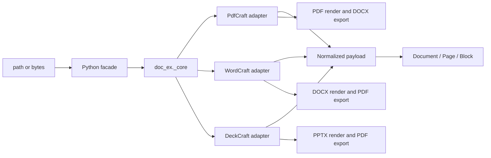

# Design: Rust document engine

## Summary

`pydoccraft` is a mixed Python/Rust package licensed under Apache-2.0. Python retains the stable PyMuPDF-style `doc_ex` API and Markdown rendering. A private PyO3 extension, `doc_ex._core`, adapts pinned upstream ArtCraft engine crates from PdfCraft, WordCraft, and DeckCraft. No desktop UI, CLI, MCP, networking, updater, or subprocess component is linked.



## Dependency policy

Every upstream repository is pinned to an immutable release commit:

- PdfCraft v0.9.0: `645016addcfb9078c557f0189559ab47cdcee057`
- WordCraft v0.8.0: `f2e15cf8f899a79899a2d9595ca4ce7df1e5ea22`
- DeckCraft v0.8.0: `22db9261f9d1a214c296fd390173130c45d76d66`
- Craft PDF backend patches use the immutable `craft-libs` revision required by WordCraft/DeckCraft.

Rendering and conversion dependencies are currently unconditional in the release wheel; only operation-specific upstream crates are linked, and no application umbrella crate is used. A locked license audit must permit Apache-2.0, MIT, BSD, ISC, Zlib, Unicode, and similarly permissive licenses; GPL, AGPL, and LGPL-only dependencies are rejected.

## Native adapters

### PdfCraft

`pdfcraft-render`, `pdfcraft-cos`, `pdfcraft-edit`, and `pdfcraft-create` open PDF bytes and expose page metadata, positioned reading-order text, links, and images. PDF→DOCX maps those public values into `pdfcraft-export::Page` and calls `pdfcraft-export::docx`, preserving the upstream conversion implementation without linking the application engine, JavaScript, automation, printing, or UI crates.

### WordCraft

`wordcraft-docx::read_with_password` returns the public `wordcraft_doc::Document`. The adapter recursively walks ordered `Block::Para` and `Block::Table` values, resolves inherited heading levels, run hyperlinks, inline images, comments, and explicit page breaks. `wordcraft-layout` supplies computed pages and `wordcraft-render` supplies page images. DOCX→PDF uses `wordcraft-pdf`, and upstream Markdown may be used for fidelity checks.

### DeckCraft

`deckcraft-pptx::import` returns the public presentation model. The adapter recursively walks grouped shapes, text paragraphs/runs, hyperlinks, tables, notes, comments, and media. `deckcraft-render` renders slides and `deckcraft-pdf` exports PDF.

## Python boundary

```python
_core.extract(data: bytes, filetype: str, password: str | None) -> str
_core.extract_text(data: bytes, pages: Iterable[int] | None, password: str | None) -> str
_core.convert(data: bytes, source_format: str, target_format: str, password: str | None) -> bytes
_core.render(data: bytes, filetype: str, page: int, dpi: float, password: str | None) -> bytes
```

JSON remains the narrow structured-extraction ABI. Images are base64 encoded only across this boundary. The additive PDF `extract_text` fast path returns bounded form-feed-separated text directly and deliberately omits structured values; DOCX/PPTX use the existing eager model fallback in Python. Both the Python facade and native PyO3 boundary collect at most 10,000 requested indexes with one bounded lookahead; the all-pages path uses an index range with the same cap. Native glyph UTF-8 lengths plus an upper bound on separators are checked before upstream `plain_text`, and Office accumulation counts UTF-8 bytes incrementally before joining. Upstream glyph construction remains outside this output-budget guarantee; streaming/peak-memory acceptance stays open. `render` returns PNG bytes. Python hydrates typed `Document`, `Page`, `Block`, `Table`, `Cell`, `Link`, and `Image` values.

## Conversion matrix

| Source | Target | Upstream implementation |
|---|---|---|
| PDF | DOCX | PdfCraft public extraction values mapped into the `pdfcraft-export` DOCX writer |
| DOCX | PDF | WordCraft PDF export |
| PPTX | PDF | DeckCraft PDF export |

Other pairs fail explicitly. Conversion fidelity and warnings are those of the pinned upstream release.

## Rendering

`Page.get_pixmap(dpi=144)` and `Document.render_page(page, dpi=144)` return PNG bytes. PDF uses PdfCraft rendering, DOCX uses WordCraft layout/render, and PPTX uses DeckCraft rendering. PDF eager open privately retains the same PdfCraft `PageRenderer` used for text extraction and reuses its parsed document for later renders; `Document.close()` drops that state while hydrated values remain owned. The one-shot `_core.render` boundary remains for non-session routing and compatibility. DOCX layout reuse is still pending. These dependencies are included unconditionally in the current wheel; extraction-only feature builds are not implemented.

A private `rendering` helper validates finite DPI, raster dimensions and RGBA length. PDF/DOCX encoding unpremultiplies color channels and writes PNG physical resolution; PPTX retains upstream `to_png_at`. The shared raster budget is 64 million pixels. WordCraft/DeckCraft dimensions are preflighted before raster allocation; PdfCraft already enforces the matching pixel budget with `reject_oversize`. DeckCraft's caught-panic blank-image behavior remains U09; local code cannot reliably distinguish that output from an intentional blank slide.

## Normalized model

The normalized payload preserves zero-based pages, ordered blocks, links, images, tables, comments/notes, optional geometry, and format-specific metadata. Markdown remains in Python. PDF tables use upstream Office-export inference for conversion; extraction exposes conservative table candidates derived from public glyph geometry because PdfCraft v0.9.0 does not publish its detector.

DOCX `TablePayload.cells` recursively owns `CellPayload.blocks`, spans and vertical merge state. The existing flat `rows` stays compatible. Python renders nested/merged/rich cells as escaped HTML tables inside Markdown and suppresses already-emitted cell assets in the page appendix. Empty cell structure is omitted from serialized PDF/PPTX tables. This schema is extraction output, not a replacement authoring document model.

## Safety and errors

Upstream bounded parsers handle object/package limits and malformed content. The adapter adds OOXML archive preflight limits and validates render DPI and output dimensions; input is bounded at 128 MiB and normalized JSON at 64 MiB, with format-specific media/story limits. Total execution time and whole-process peak memory remain caller-controlled. No native adapter performs network access. Upstream errors are mapped to stable categories: unsupported, malformed, encrypted, resource limit, and conversion failure.

## Testing

Tests use generated fixtures and upstream project fixtures where licensing permits. They cover extraction structure, links, media, tables, comments/notes, multi-DPI dimensions/metadata/visible output, conversion reopen, malformed input, close semantics, and Python error mapping. `tools/validate_installed.py` compares imported package files with the wheel before running the corpus and writes machine-readable evidence. Release validation runs formatting, tests, Clippy, a locked license audit, wheel build/install, footprint measurement, and a scan proving no direct parser or external CLI path remains.

## Planned extensions

The [feature roadmap](../../../TODO.md) distinguishes existing rendering from pending DPI validation/metadata work and new authoring work. Creation and save are now exposed by the initial native authoring profile below. Proposed DOCX authoring must adapt WordCraft's public model/writer; PDF authoring must adapt PdfCraft's public creation APIs. Verify these APIs at the pinned revisions before extending the typed Python facade and narrow native boundary. Do not serialize formats in Python or expose upstream Rust types.

Structured reports may reuse DOCX creation followed by the existing WordCraft PDF exporter. Preserve the current extraction model and bytes-returning render/conversion contracts. Source locators, recursive table content, and diagnostics should be additive, with explicit limitations when upstream lacks exact geometry or semantics. These are design directions for the backlog, not implemented behavior.

### Python authoring facade

The [authoring API proposal](../../../docs/authoring-api-design.md) defines a Pillow-like direction: a simple factory, typed editable objects, named properties, explicit units, independent copying and explicit saving. Microsoft Open XML SDK supplies feature coverage references only. The API belongs to pydoccraft and does not expose C# schema classes, engine-specific Rust objects, or raw package editing as the normal user path.

An explicit edit-copy operation must retain the full upstream model from original source bytes; extracted `Page`/`Block`/`Table` values are insufficient to reconstruct arbitrary documents safely. Existing extraction values remain owned snapshots. Editable DOCX sections represent flowing content; PDF pages and PPTX slides retain fixed geometry. Changes invalidate layout/render state consistently, with explicit handle lifetime rules.

New native operations must remain narrow and bounded. Final session/serialization interfaces are deferred to API8 until pinned public upstream APIs are audited. Python performs API validation and explicit path/stream I/O; upstream libraries own mutation, serialization, layout and format-specific algorithms. Unsupported public capabilities require upstream work rather than another backend, handwritten XML/PDF serialization or application crates.

The expanded table/background roadmap distinguishes semantic cells, native document background, anchored drawings/watermarks and raster preview backgrounds. These have different scope and preservation rules. A compatibility ledger must track read/create/edit/preserve/render/export independently; no-op save and unknown-part handling are required before advertising safe editing. Planned tests and upstream blockers are recorded against stable roadmap IDs.

### Overlap review and upstream ownership

The [canonical workstreams](../../../docs/roadmap-workstreams.md) consolidate 139 coverage IDs into 14 ownership units, with an exhaustive JSON mapping. Keep recipes and acceptance scenarios distinct from implementation primitives. Use existing PNG methods, content insertion, ordinary properties, safe copies and ordered collections; no extra rendered-page wrapper, report builder, template language, batch API or public session framework is planned.

The [upstream register](../../../docs/upstream-roadmap.md) records a pinned-source audit. WordCraft and DeckCraft writers and numerous editing/background primitives already exist. Confirmed focused candidates include a public PdfCraft table detector, a fallible DeckCraft render path instead of blank-image fallback, and lower-level WordCraft revision-resolution routines currently located in engine code. Public availability, current integration and verified fidelity are separate states. Missing format algorithms belong upstream; adapter code must not duplicate them or link prohibited engines.

## Native authoring profile (unreleased)

`src/doc_ex/_authoring.py` owns Python object identity, units/colors, ordered collections and explicit filesystem persistence. `author_docx.rs`, `author_pdf.rs` and `author_pptx.rs` own private PyO3 native document models. These private types serialize bytes through the selected upstream writers; no upstream type crosses the Python boundary. Existing `_core.extract`, `_core.render` and `_core.convert` remain compatible.

Document creation uses WordCraft `Document`, PdfCraft COS/create/edit/organize, and DeckCraft's blank model/public PPTX writer. Native mutation operates on owned models and validates compound changes before committing. DOCX revision-bound ranges use Unicode character offsets and checked story/path locators. PPTX handles resolve stable native slide and shape IDs after slide reordering. PDF page/annotation handles are invalidated after structural changes when indexes can move. Cached Python extraction snapshots are invalidated on mutation.

Existing PDF `Document.edit()` passes original source bytes to the conservative native edit profile. Office source editing is refused until unsupported package content can be diagnosed. This avoids reconstructing editable documents from incomplete extraction snapshots. New authored Office models are editable throughout their owned lifetime.

`save(path)` serializes first, writes a same-directory temporary file, preserves an existing mode and replaces atomically; native code does not write caller paths. Stream writes report incomplete writes without claiming rollback. Scope and format limitations are published in `docs/authoring.md`. Auxiliary header/footer extraction is described below; source editing still requires separate preservation evidence.

## DOCX story projection and layout controls

The native extraction payload adds optional `stories` containing `StoryPayload { kind, blocks, metadata }`. Python hydrates the same owned `Block`, `Table`, `Cell`, `Link` and `Image` hierarchy and exposes `Document.stories`. This separates source stories from computed pages; parts are not duplicated for each rendered occurrence. `Story.get_text` reuses existing page formatting without inventing a page locator. Native part-ID ordering, legacy comment projection and note references are explicit metadata. Reference-only paragraphs retain their anchor blocks. Paragraph normalization walks ordered native formatting ranges and inline objects once, keeps incremental Unicode character counts, and slices link labels at recorded UTF-8 boundaries; it does not repeatedly rescan paragraph prefixes.

Table/paragraph layout setters remain on the same native editable owner. Column widths validate the containing page/cell and nested content; row controls use the native row properties, and uniform borders respect writer precision. Explicit page breaks insert the native page-break marker in a dedicated paragraph; page-break-before remains a separate native paragraph property. No custom pagination engine or Python table-layout algorithm is introduced.

## Text, vectors and diagnostics

DOCX list membership and range links modify public WordCraft model values. Native ranges remain revision-bound Unicode offsets; links reject unsupported schemes and oversized targets. Header/footer getters use a nonmutating part lookup, while insertion creates missing stories atomically. Lists and links share normal paragraphs and ranges; no separate list/document builder is exposed.

PDF font registration, shaping, embedding, vector serialization, metadata and outline operations use pinned public PdfCraft crates. The already-transitive `pdfcraft-content` and `pdfcraft-fonts` crates become direct dependencies without adding graph packages. PDF paths accept a bounded sequence of move/line/curve commands, opaque stroke/fill and native coordinate conversion. Bookmark paths are private, structural edits invalidate unrelated handles, and originating child collections refresh only when their parent identity is unchanged. Supplied fonts remain caller input; the Inter test fixture retains its OFL attribution.

A private bounded diagnostics accumulator groups detectable native constructs by fixed code, count and source examples. DOCX and PPTX extraction populate it while walking existing models; it does not deserialize unknown source markup or create a public capability framework. DOCX text normalization consumes object and formatting iterators monotonically, retaining exact Unicode/UTF-8 link offsets without repeated prefix scans.

Python bounded reads accept bytes, paths and binary streams, preserving caller stream ownership. Native entry points recheck input size; JSON serialization writes to a bounded buffer and accounts for escaped UTF-8 output. Diagnostics and payload budgets constrain adapter output, not every upstream parser allocation. The report example composes existing DOCX methods and conversion with no new runtime abstraction.

## Formatting and portable content projection

A bounded flat scalar patch crosses the private native authoring boundary. WordCraft character/paragraph values and public overlays/resolvers implement direct-property clearing and inheritance; no Rust model is deserialized from caller JSON. Named paragraph/character style handles resolve immutable native IDs, validate the entire affected inheritance graph, and expose direct or resolved property snapshots. Native table context participates in paragraph-spacing resolution. The Python facade uses typed keyword maps and a shared range/collection vocabulary, rather than a public formatting schema or builder framework.

PPTX ranges map flat Unicode offsets (including LF paragraph separators) to public DeckCraft edit positions after strict bounds checks. Native revision counters invalidate incompatible ranges. New links construct only URL or stable SlideId actions; whole-document checks protect reorder/deletion and account for links in tables, notes and grouped shapes. Native split/allocation preflights bound run/property growth before mutations, including existing whole-shape setters. Canonical readable underline names are projected to native tokens inside Rust. Mixed hyperlink reads remain explicit errors, while assignment can replace or clear the range through a private permissive lookup; stale/range checks still run first. Link URLs share native text validation so serialization cannot silently remove invalid XML characters.

Portable Markdown returns `dict[str, bytes]`; the mapping itself is the in-memory package. A private image-reference callback flows through existing page and recursive table formatting. Content hashes deduplicate media independently of placement identity. Generated paths cannot inherit traversal from source filenames; story files use numeric names and relative media references. A preflight walks bounded nodes/depth and estimates escaping growth, then package/manifest serialization checks aggregate encoded bytes. Existing source hyperlinks remain caller-visible data and are not fetched or sanitized.

## Section identity and native grid mutation

DOCX section IDs are append-only ordinals over native section-ending paragraphs. The Python Section retains its ID and routes fixed-shape property patches to that native section. Appending materializes independent part IDs using public native part creation and clone-on-write blocks; shared immutable media stays owned by the document. Missing header/footer references become independent empty parts to avoid implicit previous-section inheritance. Synthetic section markers stay outside ordinary paragraph collections. Existing native writers generate relationships.

PPTX table structural generations are keyed by stable native shape IDs. Shared Python table/row/cell wrappers dispatch using the existing format-specific argument prefix; they do not introduce another table schema. Public native grid functions implement structural edits, while adapter preflight rejects unsupported overlap/size cases and validates resulting budgets. Covered coordinates map to an anchor, the rectangular text view emits content only there, and changed-table generations reject stale positional row/cell handles. Explicit minimum-height/border limitations follow the pinned renderer rather than being emulated locally.

Cell margins/alignment reuse native public properties in both adapters. Direct alignment getters distinguish None inheritance from an explicit setting; resolved margin getters use native defaults. Ordinary letter-template and independent-copy loops live in an example file, leaving template syntax, data formatting and batch policy outside the package API.

## Grid structure and PDF geometry

DOCX now shares the existing Python table grid verbs with PPTX. Native per-table generations protect positional handles; structural edits unregister descendants while stable table IDs and unrelated handles survive. Public WordCraft grid mutations run on staged models with pre/post validation; surviving native block identities retain synthetic cell-placeholder bookkeeping. The adapter rejects orphan vertical-merge continuations instead of copying the missing native anchor-repair algorithm.

PDF page boxes use public organize BoxSpec and PageInfo coordinate transforms. A staged write/inspect refreshes effective geometry and sizes before commit. Python invalidates page-related handles and cached render state; changed-page backgrounds become unknown. RGB color is applied to native content operations, including supplied-font glyph operations. Native ContentTruncated warnings and outline_more inspection flags map to explicit resource-limit failures.

## Native notes and owned PDF fields

DOCX note creation builds a public native PartKind story and inserts a NoteRef at the checked UTF-8 offset derived from the Python character range. Built-in note/reference styles and native section NoteProps supply rendering and numbering. The ordinary story/paragraph facade is reused; native part identities stay private. Generic commit preflight compares semantic marker identities/multiplicities and rejects orphaning or duplication. Whole-document cloning preserves note parts; arbitrary fragment copying remains upstream work. Note body text stays editable; serialization supplies the native own-note mark.

PDF fields use the lower-level pdfcraft-forms crate at the existing PdfCraft revision. Only new owned models and their clones enter bounded field enumeration; imported AcroForms remain rejected. Shared Python field collections filter by page and index by immutable name. Structural field/page generations prevent stale handles from binding to a recreated name. Native mutations clone/stage, enforce a shallow script-free single-widget profile, validate fixed Helvetica appearances with native width metrics and reject undrawn fields/NeedAppearances. Existing native flatten performs removal; postconditions gate commit. Page organization revalidates the profile. No PDF field-tree or appearance serialization is implemented locally.

## Table formatting and outline-aware imports

Count construction expands only a bounded blank string grid before entering existing native constructors. Slice access returns ordinary lists of existing cell handles, avoiding a new collection/view abstraction. Typed formatting dictionaries are bounded before native conversion; table/cell patch handlers stage native property changes and reuse existing grid/content validation. Native layout checks effective available geometry, and public measurement/autofit determines fitted columns. Direct formatting snapshots do not claim resolved conditional styles or complete shared-edge border precedence.

Outline-aware imports add one optional keyword to the existing page insertion method. The adapter preflights source native bookmark snapshots/semantic keys, then calls insert_file_pages with native conflict policy. Source/post-copy snapshots verify count, depth, title/structure and supported destination mapping; the adapter does not serialize or remap outlines itself. Existing page generations invalidate related handles. Default imports and subset copies keep their documented no-outline policy.

## Conditional styles and multiline PDF labels

Table styles extend the existing style kind and formatting dispatch. WordCraft Style table parts and StyleSheet resolution own inheritance and conditional properties. The facade adds one optional region argument and table style/look patch keys, avoiding parallel cell-style or conditional-format builder objects. Native layout supplies one cell-width snapshot for affected-table validation, including ancestor and unregistered nested tables. Explicit margins and changed inherited margins must retain valid content allocation. Table-style snapshots distinguish base-chain resolution from final cell appearance.

PDF links share one bounded native text/provenance index containing normalized text, glyph byte/Unicode offsets and uniquely matched surviving paragraphs. Native line/text APIs determine spaces and newlines. Candidate selected glyphs must be contiguous and uniquely owned; accepted multiline block intervals merge only when they overlap. A single block rebuild joins exact native text and remaps all accepted labels, including adjacent single-line annotations. Failed identity, geometry or substring checks leave labels unresolved. This annotation-driven normalization neither infers columns nor changes plain-text extraction.

## Native region rendering and DOCX tabs/breaks

One optional clip tuple passes through the existing render entry points to `_core.render`. A shared private raster-region helper intersects displayed-page coordinates and snaps outward against the backend's existing scale/pixel extent. PdfCraft tile requests, WordCraft affine region rendering and DeckCraft offsets perform native rendering. Full-page branches retain their prior behavior. Native result dimensions must match the checked region; no recoloring/cropping workaround substitutes for unsupported transparency. Kurbo is promoted from an existing transitive dependency to an exact direct dependency solely for the public WordCraft transform type.

DOCX tabs extend the existing paragraph patch/snapshot representation. Native ParaProps tab values and style resolution own stop accumulation/clearing; preflight rejects unsupported enums, imprecise/duplicate positions and effective lists exceeding native serialization capacity. Break insertion uses public native text operations with a checked marker and existing text budgets/semantic guards, returning the normal revision-bound range. Page/column context checks keep unsupported story/table pagination explicit. No new tab collection, break object or pagination algorithm is introduced.

Extraction retains explicit segment source-byte starts and maps them to native placed-line ranges from the existing layout index. Binary searches over ordered segment starts avoid rescanning every line for each break. Column segments may share a page; earlier automatic wrapping no longer shifts explicit segment assignment. Remaining automatic wrapping within a segment retains the first-page projection limitation.

## Style relationships and document defaults

Style information adds canonical next/linked IDs; the facade returns the same owned Style handles. A bounded private relation patch stages native metadata changes and reciprocal link updates, while inheritance validation remains limited to based_on edges. Next relationships permit cycles; occupied linked partners are rejected before changes to the old pair. The implementation does not invoke excluded editor commands.

Document defaults reuse native default_chr/default_para and the existing character/paragraph patch parsers. Paragraph edits mark the native default paragraph part present for serialization. A flat direct snapshot follows the existing formatting vocabulary, with paragraph shading owning the background key. Native style/context resolution and shared affected-table/tab validation gate commit. No separate defaults owner, style-selection engine or property-inheritance implementation is introduced.

The pinned reader materializes an omitted default font size as 10pt while the raw resolver falls back to 11pt; default-size reset is therefore rejected before mutation. Other supported clears have effective-formatting readback coverage. Built-in heading links can reference absent companions: the facade reports that unsupported relation, while native clearing/replacement repairs the source without touching unrelated styles.

## PDF drawing resource preservation

Drawing mutations already stage a cloned native document. Before committing, a shared guard obtains effective inherited resources through public pdfcraft_model page traversal and compares existing font/image/graphics-state bindings. Unchanged native objects and a small supported scalar-dictionary equality profile allow normal repeated drawing; unprovable replacements fail explicitly. This protects original content without copying a PDF resource allocator or adding public API. The already-transitive model crate is a direct same-revision dependency.

## DOCX pagination visibility guard

Before native serialization, collect rows whose native layout cannot split them and whose cells have no vertical-merge geometry. Skip layout when that set is empty. Otherwise inspect public WordCraft placed-cell rectangles against physical page height, with bounded page/item traversal and explicit failures. This uses the native paginator and protects all authoring snapshot/render/export/save paths, including changes to fonts, margins and text. Traversal bounds follow layout allocation and are not a streaming memory guarantee. Exact-height clipping within a page is intentional; vertical merge anchors span rows and require separate upstream overflow evidence.

## PDF text areas and image transforms

The facade adds optional parameters to existing draw_text/add_image. A private text-box entry point shares native helpers with legacy point text; public native line/width/occupied-rectangle APIs validate built-in wrapping, while existing shaped font placement retains explicit-line behavior. A conservative bounded wrapping-work estimate gates repeated native layout. Images pass checked crop, rotation and flip properties to AddedImage, translating Python left/top/right/bottom order to the native order. Every staged path retains the resource-preservation guard; no raster crop, replacement text layout or new public drawing class is introduced.

Supplied TrueType box text uses native shaped glyph IDs/positions and bounded public Skrifa outline drawing; Kurbo computes curve extrema. Preflight traverses native parsed component references before recursive native lookup, then bounds scratch and path accumulation. Cached bounds reuse repeated glyphs without duplicating font parsing or shaping algorithms. Boxed CFF is rejected because the public evaluator cannot enforce an aggregate work limit. Built-in text retains logical metrics.

## DOCX paragraph borders

ParaPatch reuses the bounded border-value parser and records optional side changes, applying them to existing direct border properties. Native StyleSheet resolution supplies effective whole-group inheritance; no per-side paragraph cascade is invented. Paragraph and default snapshots expose four edges, while table-style snapshots retain the six-edge table border group. Shared side-aware DOCX validation excludes proven unsupported styles, widths and orientations. The facade reuses its existing border mapping normalizer; no new border object or method family is added.

## Ownership and shading acceptance

The private collection iterator captures its ordinary owned handles together with membership before yielding. Existing per-object identity/generation checks remain authoritative; the iterator does not mint fresh positional generations after a structural mutation. No public collection framework is added. Shading acceptance exercises existing native character/paragraph/table-style resolution and existing background/highlight patches, including independent page color; it requires no runtime implementation.

TBL7/BG7 retain the existing formatting surface. Cell background snapshots remain direct values; `None` removes the direct override and restores inheritance. Whole-table and conditional style fills already provide native solid table appearance. Do not add a direct table/row fill setter while native layout ignores those properties, or interpret white/`None` as explicit transparency. Patterns, editable theme identity and cancellation of inherited fill need upstream model and resolution support. Existing conditional-border guards remain independent of these fill gaps.

Page-border acceptance first needs a raw native asymmetric-margin fixture comparing the serialized offset mode with public placed rules, then reader/write retention and visible PNG/PDF output. The current source-only page-edge/text-relative mismatch is recorded under existing U02/BG7 ownership in the [upstream register](../../../docs/upstream-roadmap.md#redaction-and-table-fidelity-audit); it does not authorize a facade setter, coordinate workaround or new completed criterion.

## Inline picture lifecycle

A small Pictures specialization adds deletion to the existing ordered collection; Picture.data uses native image_data/set_image_data through the ordinary source reader. The native document's add_media provides deduplication and collision-safe keys. The adapter follows public para_paths over body and all parts to account for its narrow authored Image/NoteRef profile, then prunes unreferenced bytes on the staged candidate before commit. It does not parse relationships or invent a general media-reference graph. Native paragraph deletion removes the sole picture marker while retaining the paragraph's stable locator. Broader graphics/background/OLE cleanup remains an upstream reference-traversal requirement.

Supplied TrueType box text uses native shaped glyph IDs/positions and bounded public Skrifa outline drawing; Kurbo computes curve extrema. Preflight traverses native parsed component references before recursive native lookup, then bounds scratch and path accumulation. Cached bounds reuse repeated glyphs without duplicating font parsing or shaping algorithms. Boxed CFF is rejected because the public evaluator cannot enforce an aggregate work limit. Built-in text retains logical metrics.

## DOCX metadata

WordDocument shares metadata/update_metadata vocabulary with PDF. Python preflights ordinary scalar values and bounded JSON chunks; native patches stage CoreProps/CustomProp values and use the existing commit path. Native typed values serialize through the DOCX writer, with authored-property budgets separate from body text/media. The extraction adapter adds supported core fields through its existing metadata projection. No generic property object, raw XML endpoint or package writer is added.

## PDF markup appearances

Existing annotation dispatch maps three additional kind strings to native Markup values. A narrow borrowed dictionary lookup preflights direct QuadPoints before native props() can build an appearance; resource estimates follow the native bounded vertex count without generating geometry. Staged generated AP stream lengths are read without decoding imported streams and charged to existing input accounting. Deletion reads only subtype. Native add/move/style/delete and view transforms remain responsible for PDF semantics and appearance paths.

## Section gutters and native columns

Two properties extend the existing section patch/snapshot boundary. WordCraft SectionProps.gutter and Columns.widths own serialization and native column_boxes own layout geometry. Explicit widths use the existing shared gap, with no gap after the final column. Validation rejects values the native helper would clamp and prevents summed widths from exceeding usable space. The narrowest native column bounds body tables/images and nested geometry because pinned table placement reuses its initial measured grid on later columns. New unequal-section body tables start at fixed native width equal to the narrowest column. Existing tables retain their properties and must satisfy geometry checks; serialization rechecks actual native table layout after content/font changes. No column collection, orientation alias or local flow algorithm is added.

## Authored slide layouts and placeholders

Slides.add selects a supported LayoutType through native defaults::layout_of_kind and defaults::new_slide. Native edit::insert initializes empty placeholder text bodies without direct style overrides. Existing shape handles project native placeholder roles, and resolve::Ctx/resolve::xfrm provide effective geometry. Setters copy the resolved transform only when needed, then change the requested fields. The shared staged model validation protects content/ID budgets and ownership. Masters, themes and layout references remain native model data; no template copier or new placeholder hierarchy is introduced.

## Combined table corpus

A development-only fixture builder composes existing heading, table, nested-cell, image, row and formatting operations. One acceptance loop reopens DOCX/PDF and checks semantic labels independently from actual representative pixels. Expected repeated-header multiplicity is explicit for PDF and does not contaminate source semantic counts. The fixture index links the six names to their evidence; no runtime abstraction or additional document backend is introduced.

## Picture source edits and text selection

SlidePicture specializes the existing Shape handle for native PictureFill media, shape description and placement transforms. The ordinary shape factory retains its image discriminator, and source reads use the same bounded Python reader as existing authoring. Native add_media supplies deduplication; the existing authored-profile reference pruning retains picture/background resources and live-byte checks gate staged mutations. No new image collection or rendering backend is introduced.

A private _slice_range helper serves Paragraph and text-bearing Shape indexing, normalizes a contiguous slice against owned text, checks the revision around native text_range and returns the same range type used by find/add_run. SlideTable retains EditableTable indexing through its existing inheritance order. Picture source/coordinate conversions finish before resolving the stable slide identity to an ordinal. Replacement, styling and links continue through existing native methods. No range-tracking structure, native method or document-standard logic is added.

## Numbering and fixed slide navigation extraction

DOCX Adapter builds a bounded (StoryRef, Path) observation map from existing native Placed::Lines once per layout. Effective NumRef and Label.text come from native resolved paragraphs; unlaid-out stories fall back to native style/table resolution. Labels use the native label-line byte offset to select an existing explicit-break segment. Conflicting repeated placements suppress only the label. Native numbering definitions provide parsed formats/templates, including the reader's 64-character template normalization. A conservative escaped-byte counter bounds repeated metadata across page and semantic table projections. Native definition results, including misses, are cached by instance/level. A conservative cumulative scan budget accounts for the pinned resolver's repeated linear instance, abstract and override traversals before each uncached call; exhaustion rejects the complete payload. Earlier native layout costs remain separate. No local list counter, style parser or visible-glyph reordering is added.

PPTX uses a bounded SlideId-to-page map shared by run/table/shape projection and diagnostics. Action::Slide and Action::Url reuse LinkPayload; contextual actions retain factual omissions. Native relationship parsing remains upstream, including its unknown/unresolved-action losses. The map guards parsed identities but is not a pre-import allocation or source-count guarantee.

## List starts and source slide-count bounds

The existing native list setter receives an optional checked start. It creates a fresh native list definition and sets Num.start_overrides for level zero; WordCraft still owns counters, labels, layout and serialization. Reusing the setter preserves continuation/restart semantics and avoids another list object. Header/footer ancestry is checked through the existing StoryRef registry because native measurement can consume a counter before visible placement.

PPTX preflight scans one bounded eligible ZIP member at a time using borrowed quick-xml events, stopping on non-presentation roots. It counts all sldId descendants conservatively, including alternate content and secondary lists, instead of resolving OPC relationships or selecting markup branches. UTF-16 BOM decoding follows the pinned reader's normalization. Generic ZIP safety limits still apply; parsed model indexing remains a second defensive check. The already-locked MIT quick-xml 0.41.0 is a direct dependency with no new package or upstream revision.

## Existing picture and field geometry properties

DOCX Picture properties project InlineObject::Image.crop and Float.flip_h/flip_v through typed native accessors. Staged edits retain the media key, frame and unrelated Float properties; replacement continues to change only the media reference. Shared DOCX image sizing rejects the pinned layout's sub-point clamp. Native rotation fidelity is a separate upstream correction.

PdfField.box reuses current-view rectangle validation/transforms and pdfcraft_forms::set_props for widget zero. Existing checked-owned-form validation protects field semantics and fixed appearance fit before staged commit. The Python setter converts caller coordinates before its final generation check and invalidates the normal output cache on success. Field structural generations remain unchanged because widget identity and page membership are preserved.


## Private Office render reuse

A private `_open_office` boundary dispatches to format-owned sessions and returns the same bounded normalized JSON alongside a private `_OfficeSession`. DOCX owns Document and DocLayout, discarding transient LayoutCache; PPTX owns Presentation. Mutex-protected optional state shares the existing PDF close/render lifetime pattern, with public model snapshots remaining in Python. Each adapter factors its existing raster validation into one checked helper used by cached and one-shot rendering. No image result cache or new public object family is added. Private counters distinguish parse/layout builds and render attempts reaching a live session; boundary-rejected malformed clip tuples do not enter those counters.

Python keeps the existing Document._render_session dispatch and strong local reference during calls. Close clears the private source/password and consumes retained native state; failed Python hydration also explicitly closes unreturned state. DeckCraft's private thread-local renderer and allocator/global caches are not owned by this session and cannot be explicitly flushed through its public API. Retaining a model/layout trades steady-state memory for avoiding repeated import/layout; post-layout page/item checks cannot constrain upstream peak allocation.


## Page fields and property metadata

Paragraph.add_field uses native insert_object to append a Field marker and returns the existing TextRange. Explicit PAGE/NUMPAGES/SECTIONPAGES instructions with Arabic numeric switches avoid the pinned layout's inconsistent implicit page-format inheritance. Section setup reuses its existing JSON patch with page_number_start; section append clears inherited restart. Commit preflight counts fields through public paragraph/story paths, so copies and auxiliary-story edits share the bound. Native layout evaluates values; DOCX stores an empty dirty cache rather than an adapter-computed number. Range replacement/deletion remains native and must not allow raw object-marker injection. Authored fields without legacy form XML contain no media references and pass the existing image-retention walk; opaque/raw field payloads and other unsupported objects remain outside that authored media profile.

A private strict native-property-to-JSON scalar helper is shared by the existing authoring metadata snapshot and extraction. Extraction preflights count/name/kind/value bytes and ambiguous folded names before copying; unsupported/malformed/ambiguous entries are omitted with bounded position-only notices. Existing table payload traversal projects native caption/description under title/description, with their bytes included in the story text budget. The native reader's lossy paths are retained as explicit upstream limits, not repaired by a second XML parser.

## Bounded PDF page selections

PDF copy/subset and page insertion reuse the private `_selected_pages` facade helper already used by selective text extraction. Bounded integer collection precedes native dispatch; copy resolves valid negative indexes against one stable final count. Destination page generation plus count detects incompatible callback mutations, including append-only page additions that preserve existing positional handles. Open-state validation runs before stale-selection validation. Native PdfCraft remains responsible for page import/subset semantics and preservation restrictions; source bytes are snapshotted before consuming selection callbacks.

## Executable usability cookbook

Five new standalone example modules plus the existing template recipe compose native authoring and PNG-byte rendering. Each exposes a normal function with an explicit output directory and a guarded argparse entry point. They format domain data with Python/Decimal, preserve native document ownership and write returned conversion/render bytes explicitly. No example implementation enters the public doc_ex surface. Installed-wheel acceptance imports the actual modules and runs their CLIs in temporary directories; shared PNG decoders verify artwork and requested resolution without requiring Pillow.

## DOCX image backgrounds

WordDocument.background_image reuses bounded Python source reading and native PNG validation, with private native background_image/set_background_image methods on the existing editable owner. The adapter assigns public Settings.page_picture to a PagePicture with frame fill and a media key returned by Document.add_media. Image and color remain independent native settings. The existing authored media-retention walk includes this one global reference before paragraph images; shared data counts once, and it is not counted as an inline placement on each rendered page. Empty-media commits still validate a nonempty background reference. No separate background object, image compositor, layout logic or image-processing dependency is introduced.

## Presentation cell paragraphs

A private Paragraph adapter reuses existing slide ranges and shared slicing/find/replace helpers. Its private target contains canonical row/column, paragraph ordinal, table generation and cell body generation; optional private keyword forwarding lets existing native text/range methods select a cell paragraph without duplicating a method family. Native helpers resolve the public TextBody and relative Pos values, while DeckCraft edit functions own insertion, deletion, formatting and link runs. Appending to a body with no paragraphs uses native first-paragraph insertion without a separator. Grid edits prune cell-generation entries and advance the table generation so old raw targets cannot revive. No cross-paragraph identity remapping is implemented.

Shared literal find/replace normalizes validated string operands with base str semantics before truth, length, equality, handle capture or staged mutation. String-subclass hooks must not execute inside a replacement transaction and overwrite caller-owned changes.

## Everyday API typing and handle representations

Private standard-library input aliases, typing.Self and literal overloads retain existing runtime signatures and small root exports. Deferred annotations avoid importing authoring implementations into extraction at runtime. Existing factory overloads and generic collections remain the common ownership vocabulary. Three child reprs inspect only stored identity and owner.closed, with a no-ID fallback for the private slide-cell paragraph adapter. A strict mypy consumer checks installed-package result types; imported-module diagnostics are silenced only to scope this gate to user chains, not to certify internal package typing. Pinned checker dependencies live exclusively in development tooling.


## Bounded operation evidence ledger

The development JSON records references, fingerprinted fixture sources, seven initial operation profiles and all 139 coverage joins. The stdlib generator derives criterion text, checkbox state, owner and role from the existing roadmap and renders one Markdown support matrix. It validates structural/reference drift without importing document engines or running conversions. Supported cells retain the historical cookbook artifact identity and explicit audit baseline; matching test hashes do not promote that evidence to changed native/facade code. Separate SDK/PyMuPDF member enumeration remains unfinished, and there is no public support-query object or dispatch framework.


## Pinned reference-family discovery

A separate comparison inventory describes 44 families with 194 representative members from 17 cited immutable source files. It stores source provenance and family-to-criterion/profile mappings, not tested operation statuses or duplicated ownership. A stdlib checker derives the readable guide and all-criterion reverse join, optionally verifies an explicitly supplied local source cache, and performs no network access. The support matrix links matching reference families after validating the inventory. Comparison-product names remain references; ArtCraft format crates alone own runtime behavior.


## 51. Header/footer rich-content reuse

EditableStory delegates table/picture creation and direct-child discovery to private native methods, reusing existing input normalization and atomic owner staging. Native adapters validate Header/Footer ownership and use the minimum full text width of referencing sections. Notes remain explicitly unsupported. A separate story_placeholders map tracks only synthetic empty anchors; table insertion leaves a trailing anchor, while image/text insertion consumes it. Section/document copies preserve or remap this state. Removing a direct picture promotes its retained locator into the ordered paragraph collection without reusing identifiers.

The existing serialization layout guard activates for rich header/footer parts as well as guarded table rows. Public placed Cell/Image/Object frames provide physical-page checks; explicit clipping-cell path prefixes permit intentionally clipped descendants while the clipping frame itself remains checked. The existing page and placed-item caps apply after native layout. No header layout or text measurement algorithm is reproduced. Inactive variants can lack measurements for nested operations and later section geometry edits; such failures leave the owner unchanged.

The shared DOCX renderer sets RenderOptions.display.dim_header=false: the upstream default is an editor preview effect, while this package exports document images. Full/region and retained/one-shot paths therefore keep saturated story colors consistent with native PDF without changing body rendering or other display settings.


## 52. Section line numbering through native layout

Section.line_numbers follows the existing tuple/property vocabulary and passes a bounded JSON patch to SectionProps.line_numbers. Native LineNumbering and LineNumberRestart represent the settings, with source start offsets and twip conversion delegated to the native writer. The public count/start bounds match the pinned parser's representable range. No independent line counter, font measurement or page mapping is introduced.

A shared candidate validator checks section combinations and conservatively bounds numbered body work. Four units per UTF-8 byte covers native case-expansion clusters; native fields and note references shape atomically into one cluster, and inline objects add one unit. Ordinary line breaking consumes clusters plus at most a trailing empty line, while beside-float filler lines are not numbered. Tables and auxiliary stories use separate paths. Single-column restriction also excludes native column-balancing replay. Both full-layout entry points preflight directly, covering section/table geometry validation before commit as well as serialization; commit and serialization retain defensive checks.

The existing authored pagination guard activates for numbered sections and shares one layout with table/header/footer frame checks. Native DECOR_STORY items with empty paths identify labels; their placed line extents are inspected without reconstructing glyphs or counters. Label paragraphs must remain one horizontal line. Logical bounds and post-layout page/item caps do not claim peak-memory or full glyph-ink containment.


## 53. Story and line-number evidence joins

Two bounded DOCX profiles extend the existing development ledger to nine profiles and 63 operation cells. Each cites its own frozen wheel/source commit and unchanged test fingerprints. Three additional roadmap criteria gain profile joins, retaining their existing canonical owner and unchecked broad scope. The headers/footers and page-fields reference families connect to these profiles; LineNumberType is cited from the already pinned SDK schema snapshot. No runtime metadata API or duplicate capability database is introduced.


## 54. Shared formatting keys for direction and language

CharPatch maps language to native CharProps.lang; ParaPatch maps direction to ParaProps.bidi. Existing parse/clear/overlay and direct/resolved snapshot helpers carry both fields. Explicit ltr stores Some(false), while None clears inheritance. The language profile prevents values of 64 or more bytes from disappearing in the pinned reader; case and spelling remain caller-owned. Existing Python formatting TypedDicts and consumer checks gain the keys without another method family.

Native paragraph bidi resolves through styles/defaults and whole-table paragraph properties. PartFormat conditional regions retain their current special alignment support and character properties: language is supported there, direction remains explicitly invalid. Native shaping and logical alignment determine visible placement; TableProps.bidi_visual and cell text orientation remain separate. Concrete mixed Persian/Latin/digit glyph geometry and visible PNG/PDF extents validate this bounded profile, while Hebrew/emoji/combining source preservation does not imply complete typography coverage.


## 55. Standard PDF shape comments

The existing annotation adapter maps rectangle/ellipse to native Shape variants and Square/Circle readback. Existing native set_rect/set_style regenerate appearances transactionally. A borrowed dictionary validator admits only small direct geometry/color/solid-border values, bounded metadata and an optional N-only appearance reference; foreign AP bytes are not decoded. Native three-decimal rectangle/four-cubic appearance generation has fixed complexity under bounded coordinates. A conservative 16KiB allowance is checked before native work, then actual compressed stream bytes are charged, including both resize and recolor streams. This is not a zlib/process-memory guarantee.

The minimum three-user-unit dimensions retain at least one unit after native stroke inset and avoid a reproduced tiny-oval disappearance. No local drawing or path repair is introduced. Initial facade ownership checks remain before conversion, with final checks after box/color/page-index normalization so callbacks cannot retarget pages or annotations. Existing summary/inspection allocation precedes these mutation guards and remains separately documented upstream work.


## 56. Direction and geometric-comment evidence joins

The development ledger extends to eleven profiles and 77 operation cells. The direction profile cites its own 342-test artifact; the geometric-comment profile cites the reviewed ellipse artifact rather than the superseded oval spelling. Existing reference formatting/annotation families and TXT6/PDF6 join these profiles. The 44 reference families, 195 representative members and 139 criterion owners/checks remain unchanged. No runtime capability query, public method or backend dependency is added.


## 57. Named ranges reuse existing text handles

A small DOCX mapping delegates to four narrow native bookmark methods. Native para_paths/object_offsets locate validated BookmarkStart/End pairs; lookup reuses registered paragraph paths and returns an ordinary TextRange. Source-order iteration uses Document.bookmarks. End-first deletion and end-before-start insertion use public native operations. Same-paragraph relocation adjusts only the two removed own markers; it is not a general range-tracking layer. Existing semantic-anchor checks allow one exact validated pair deletion and preserve every other anchor.

The central all-story scan validates paired names and all internal link targets. It records marker offsets once per paragraph, discounts only preceding bookmark-marker bytes and requires each marker at logical offset zero or the content end. This invariant applies to every staged commit and output, including later text edits. Targets therefore cover whole paragraphs or endpoint points; interior markers split native shaping segments and are rejected. Default marker properties remain unchanged: native Marker clusters have zero advance and are excluded from line-height/trailing-alignment metrics. The shared authored pagination pass activates when bookmarks exist; it uses native layout.caret and public page_display. In the admitted authored-inline-object profile, every exported link rectangle comes from at most one nonempty linked Glyphs batch, and wrapper recursion does not multiply those calls. The conservative batch count includes repeated auxiliary stories and external links, avoiding the native 10,000 rectangle cap without duplicating native coalescing. Warped/unknown graphics remain excluded.

Source-linked vertical Placed::Lines require a separate check because their display has already lost link metadata. Linked Clip/Turned/Rotated/Figure contexts are rejected; Figure is an unaudited profile restriction, while clipped overflow and vertical disappearance have concrete native repros. All actual target carets must be on a physical page, with no fallback. Creation/movement/internal-link assignment validate staged geometry, while subsequent ordinary formatting edits are rechecked on output. Existing layout page/item limits, a 2,000,000 observed path/display-node bound and depth 32 remain distinct from native allocation guarantees.


Bookmark lookup preflight charges public body-index lengths plus each indexed paragraph layout's line/cluster lengths before calling native caret, then charges destination-page scans and per-placement source-run checks. Native PDF export caches names to positions, not resolved carets; the same conservative per-name estimate is charged for every observed internal linked glyph batch. A shared 2,000,000-unit cumulative budget also covers the display walk. Native coalescing is not reproduced. Layout/display allocation and initial document-wide name inventory remain outside this observed-work estimate.


## 58. One PDF writer with a representation switch

The Python PDF overrides add one keyword and strict bool validation; the shared private save callback retains a single filesystem/stream implementation. Destination normalization still precedes serialization. Native PyO3 exports to_bytes with a defaulted object_streams bool while an internal Rust to_bytes wrapper preserves current callers. Both call the same private serialization helper, changing only SaveOptions.object_streams and checking the complete returned vector against the existing 256 MiB limit. A small private limit parameter permits actual boundary tests for both native output representations without allocating huge fixtures. No caller-controlled output path enters Rust.


## 59. Clear a story without replacing its owner

EditableStory.clear delegates to one native clear_story operation returning whether a mutation occurred. Missing/synthetic empty stories return false; the facade invalidates its cached read snapshot only on true. Native part-kind and actual section-reference checks precede the public Document.set_story call. The replacement retains a native empty paragraph as a synthetic insertion anchor, without exposing it as an authored child or changing section inheritance.

Existing staged commit checks run before publishing location, picture, table-generation and placeholder cleanup. Only the selected story's children are invalidated, and stable IDs are not recycled. content_usage uses native object_offsets to subtract image-marker bytes only, matching established insertion accounting for fields/notes/bookmarks and correcting copied-story and cell/grid removal totals. No new resource graph, XML edit path or layout algorithm is added.


## 60. Search through the retained PDF session

A narrow private session method requests native text interpretation, checks content warnings and bounded glyph/index vectors, then delegates literal matching to PageText.find_opts_limited and geometry to line_rects. Native KMP runs in amortized O(source+query) time, but builds its source character buffer before honoring the result cap. The adapter therefore preflights UTF-8 source bytes, conservative lowercase scalar expansion and possible separators before calling it. Result ranges/line transitions are counted before geometry allocation; native rectangles remain unchanged.

The Python facade only validates query/ownership and wraps owned tuples. Editable pages reuse their checked current read snapshot. Ordinary read documents reuse the retained native parser; manually constructed documents without a session use and close a temporary native session. No raster/text-result cache or equality to normalized table order is implied. ActualText and ligature boxes can cover more than the matched substring; native reading order can cross columns.


## 61. Recheck the PDF page after normalization

The facade retains each method's initial PdfPage._check, normalizes coordinate/color/font/image-stream inputs into local values, then calls the same check immediately before dispatch. Native arguments at that point have no remaining supported user callback conversions. rotate uses operator.index before this final check, avoiding conversion while PyO3 holds a mutable owner borrow. set_box/rotate refresh the handle generation only after successful native mutation, as before.

This uses the existing generation invariant without a transaction or callback framework. Page moves/deletions performed by callbacks remain effective, while the stale requested drawing/geometry change fails. Copy-only callbacks leave the original page live and permit the operation. Read rendering continues through its captured snapshot; this change does not introduce a new rendering cache or mutable-handle rule.


## 62. Reuse native Legal numbering and placed geometry

One private matcher compares nine effective native Level values against once-per-operation native bullet/numbered/Legal definitions. It does not compare start overrides or evaluate counters. Continuation retains the existing nearest earlier same-story sequence rule, caches unique num matches and bounds cumulative native vector/override lookup work at 2,000,000 units. All authored definitions remain subject to the existing 10,000-definition cap.

A cheap canonical-Legal activation pass collects top-level source paragraph indices with owning section indices. It bounds body visits at 100,000 and target work at 100,000 (four per UTF-8 byte, one per paragraph and inline object). The existing native pagination pass supplies Page.body, section identity, Label extents and first-line caret coordinates. The adapter checks finite logical extents, resolved-direction nonintersection and body containment, without computing indentation, bidi placement or counters. Empty text carets are permitted; missing/duplicate label placements fail. Existing 10,000-page and 2,000,000-item limits remain, with a cumulative 2,000,000 label-glyph/run/caret scan budget.

Assignment validates staged geometry; every commit rechecks cheap scope, and save/render/export recheck geometry after later formatting. There is no cell-map framework, ancestor transform reconstruction or second paginator. The new profile does not change the old bullet/numbered narrow-cell limitations or imply arbitrary glyph-ink containment.


## 63. Resolve presentation ordinals after normalization

PPTX handles retain stable slide and shape IDs, unlike the conservative PDF page-generation model. For Slide.background and Shape.rotation/fill/box/color/font_size/add_run, the facade first validates a slide through its existing number lookup or a shape through the cheap native shape_placeholder lookup. It then normalizes numeric/color/format inputs and resolves the current slide index again for native mutation. Existing native per-slide shape lookup rejects deleted shapes; no identifier-to-ordinal cache or replacement handle is added.

The same callback discipline applies to generic range formatting: an initial existing revision query provides fast stale/closed rejection without retrieving text, while the native mutation still enforces the captured range revision after callbacks. Changes made by the caller are preserved; this is not automatic rollback of callback effects.


## 64. Guard native conditional-edge loss in the existing style parser

The staged conditional table-style border branch first runs the shared border parser, then examines only explicitly supplied non-null sides against the native TablePart. Unsupported combinations raise the existing unsupported error before candidate commit. There is no table-layout scan or new resource accounting: the restriction follows the reusable style definition independently of current attachments.

Pinned region_borders converts conditional edges into cell left/right values and clears inside_v; subsequent interior selection reads the cleared inside_v instead of those mapped values. The adapter records and rejects that native limitation, retaining native source generation and layout as the sole authorities. Explicit nil suppression is affected in the same way; None remains a safe removal of the direct override.


## 65. Tooltip metadata through the existing owned-field model

field_payload adds the existing native Field.tooltip string, and one narrow set_field_tooltip operation sets FieldProps.tooltip on a cloned document. Empty input removes native TU. Full expected-field equality checks that value/default/options/flags/widget geometry and identity remain unchanged, then existing owned-field appearance inspection charges regenerated raw bytes. The conservative appearance reservation helper is shared with widget-box updates; tooltip metadata has its own bounded input charge and participates in the existing aggregate live text budget.

The facade uses base str length/conversion/encoding operations and retains initial/final structural checks. No generic form-property patch language, new field container, imported-form reader or metadata renderer is introduced. Native metadata updates can allocate replacement appearances even when pixels remain identical; this is not a constant-allocation operation or secure removal promise.


## 66. Native lock flag with a bounded target profile

The existing annotation JSON adds Summary.locked, and one private setter delegates to public pdfcraft_annot::set_locked. The facade uses an actual-bool check. The setter first borrows the page Annots array, rejects inline entries before native annot_ref can clone them, and validates the selected dictionary against a <=20-entry canonical schema. It permits bounded scalar metadata, finite direct geometry, existing bounded markup quads, canonical geometric borders and a reference normal appearance. It does not decode appearance streams or traverse imported reply graphs.

Notes use native flags28/156; the other six supported comment kinds use4/132. The existing rectangle/ellipse guard admits4/132 so locked text editing and later unlocking remain usable. Copies are reserved conservatively using the page reference count and bounded target data; a flag change charges a small scalar mutation and no appearance regeneration. The staged target must equal the bounded original with only F changed. No field/widget framework, ownership tracker, format parser or general mutation language is added.

Native move/set_rect/set_style/set_info/delete check Locked; set_contents and set_locked do not. Links use a different setter that does not enforce the flag, so the property rejects links. Native Invalid retains its existing DocExError mapping. Readback uses the existing permissive Summary flags interpretation (including integral real numbers) and retains its inventory limitations; it does not certify imported dictionary validity.


## Incremental navigation, lifecycle and output evidence

Five additional profiles reuse the existing seven-operation ledger schema and generated support/reference guides. Existing roadmap ownership remains the sole source of owners and checkboxes. The new profiles cite the already validated a94a5ba runtime artifact; their reviewed test-file digests match that runtime exactly. This documentation join does not build or certify a new wheel. Bookmark source inventory, broad imported preservation, advanced output profiles and auxiliary numbering remain explicitly outside the corresponding tested scopes.


## 68. Note conversion through native semantic editing

Notes.convert normalizes a short literal kind, calls the native conversion entry point and invalidates the cached snapshot only when the returned count is nonzero. Native preflight charges paragraph/object/run work through public paragraph paths within the existing authored nesting bound; the potentially quadratic converted-reference/run comparisons are charged before calling Document::convert_notes. Text scanning remains bounded by the existing live-text budget.

The conversion-specific private commit allowance validates original part IDs/kinds and the exact expected semantic-anchor map before running the ordinary commit guards. Ordinary edits cannot use this allowance. No locator, ID, cell/media/text budget or section setting is rebuilt: native conversion changes part/reference kinds and standard note styles in place on the staged model.

The native operation changes an entire containing run's standard reference style. Preflight uses public object offsets to permit changed standard-style runs only when their complete byte spans contain converted markers. Other shared content fails explicitly; custom styles remain unchanged. The raw native source/PNG/PDF regression records the upstream behavior, while public recovery uses existing style/range formatting. There is no local run split, counter evaluation or note placement algorithm.

## 69. Extend coherent profiles without duplicating certifications

The existing pdf.owned-fields profile adds field.tooltip and public native FieldProps/Field references. Only read/edit_authored/preserve/render cells that gain tooltip evidence move to the exact tooltip artifact; creation keeps its historical citation. Existing creation/value/geometry tests and the new tooltip module are fingerprinted at that artifact, but saved output pixels do not establish imported field metadata inspection.

A separate pdf.comment-locks profile covers the flag property across seven comment kinds without certifying their creation/style APIs again. It reuses PDF6 and REF-PM-ANNOTATIONS, keeps bounded imported rectangle/reopened-native evidence explicit, and leaves creation/export not applicable. Cached immutable reference citations add Widget.field_label and Annot.set_flags while stating local default/subset differences. No capability-query framework, ownership database or new criterion is introduced.


## 70. Reuse owned-field flag and appearance paths

field_payload adds Field::read_only(), and one private set_field_read_only method toggles only flags::READ_ONLY in the expected native Field before calling FieldProps.read_only/set_props. checked_owned_fields masks only that bit when checking the existing canonical zero or COMBO base flags. No generic public flags setter, imported reader or additional field kind is introduced.

The existing owned_field_appearance_peak and owned_field_appearance_bytes helpers reserve/charge redraw work just as for tooltip and box changes. Complete Field equality verifies unrelated metadata/widgets/values/defaults/options. set_props permits changes to read-only fields and regenerates AP; native set_value independently refuses filling. Its existing conversion_failure mapping remains DocExError. The facade adds no override path and retains earlier value-validation errors. Widget Locked is separate and is not exposed by this property.


## 71. Remove the existing slide background override

A narrow private clear_background(slide) stages Slide.background=None through the existing model mutation path. The facade accepts None on the existing background property; color assignment keeps existing coercion and initial/final identity checks. Getter behavior stays direct: no override yields None even when the native effective background is an inherited image or gradient. Native resolve::background owns layout/master/theme fallback, serialization omits p:bg, and native rendering/PDF export observes that same model.

Only explicit-picture removal invokes existing authored media pruning and live-budget refresh; solid/absent reset cannot release media. Before that pruning, direct picture backgrounds in native master/layout fixtures are rejected rather than removed accidentally. This narrow safety check does not enable arbitrary imported asset graphs or add a generic reference walker. Successful repeated reset still follows normal revision/cache invalidation.


## 72. Character spacing through the existing native patch

CharPatch maps letter_spacing to CharProps.spacing and clears that optional field on None. A small scalar validator rejects nonnumeric/nonfinite/out-of-bound or non-twip values, allowing at most four f64 machine-epsilon units scaled by magnitude for ordinary arithmetic. It canonicalizes the accepted integer-twip value before f32 conversion; snapshots convert stored twips back to point values without float-storage noise. Native resolver limits [-100, 100] are checked before mutation instead of silently clamping. No per-character positioning loop, layout cache or new public object is added.

Existing overlay/resolution carries defaults, paragraph/character styles and conditional table character regions. Existing Python formatting TypedDicts and the strict consumer gain one key. The initial PPTX unknown-property rejection is superseded by the bounded existing-key extension in section 74. Native source fixtures distinguish intentional negative overlap from corruption: all source text stays owned/exact, while visual PDF text inference may reorder or insert spaces. Pure-text acceptance compares whole images; rich-story fixtures compare every chromatic text pixel and exact text bounds because the zero-spacing baseline already has independent grayscale table-grid raster differences. This is no broad pixel-perfect conversion claim.


## 73. Reuse operation profiles and distinguish semantic mutation from export

Owned-field read/edit/preserve/render cells add read_only assertions and the exact 423 artifact; creation retains its earlier artifact and imported/format-export limits are unchanged. A new note-kind mutation profile uses the 419 artifact, with stable owned handles and explicit custom-style/native-placement limits. Its export cell refers to the separate document.convert("pdf") operation. A slide background-reset profile uses the 426 artifact and distinguishes explicit getter absence from native effective inheritance. Raw inherited-model controls do not establish arbitrary imported source editing.

All profiles keep the existing seven-operation schema, 139 coverage joins, 14 owners and immutable reference families. The existing widget reference file supplies one additional representative field_flags member, with local READ_ONLY-only behavior explicit. Profile generation/checking validates links and drift, not semantics; exact historical test/runtime evidence remains necessary.


## 74. One slide formatting case, native placement

FormatPatch adds a Spacing(Option<f64>) case and sets only RunProps.spacing. The small scalar guard uses the same point/range/precision policy as DOCX while retaining f64 storage for DeckCraft; no shared layout helper or public options registry is introduced. Existing preflight_format/edited_body and native edit::format/insert own run splitting, inheritance, limits and commits. None clears the optional field; explicit zero survives native hundredth-point serialization. No source model snapshot/getter or native interface is widened.

Native resolve::run fills omitted properties from paragraph/list/placeholder defaults. Native text layout scales tracking during autofit and applies it after drawn graphemes/spaces. PDF export uses the same placed origins for its invisible glyph layer, independently of its visible slide raster. Tests compare same-glyph displacement rather than equating font advance boxes with ink bounds. The source/PDF raster fixtures use whole-pixel page dimensions at the native 200-DPI export resolution; they do not hide or repair existing arbitrary-DPI dimension quantization differences.


## 75. Validate the cell paragraph before append normalization

_SlideCellParagraph.add_run performs an existing native cell_paragraph_alignment lookup before _format_patch. This checks the canonical target and both generations and returns only an optional static enum without copying paragraph text or introducing a new native endpoint. Existing final add_run_patch validation remains after callbacks and resolves the current stable slide identity. The change is separate from character-spacing support and applies to existing supported formatting keys.


## 76. Owned note content clearing

Note.clear uses a private clear_note(id)->bool native call through the existing EditableStory method. It validates owned part kind, builds a canonical styled blank paragraph, and uses public Document.set_story without changing Part.kind/body or external references. The native writer supplies the note's own number mark as it does for existing add_note. The editable owned model never synthesizes an additional own-reference marker.

A small private clear_owned_story_content helper shares only the previous header/footer commit/accounting/publication sequence. It subtracts content_usage charges (excluding only uncharged image markers), runs unchanged ordinary commit validation, then discards that story's child locations/images/table generations/cell placeholders. The story stays owned with an empty explicit paragraph list and a synthetic placeholder at0. Monotonic child IDs are not reset. Header/footer reference/alias/no-op policies remain in their caller; note no-op requires the exact canonical styled paragraph for its current kind.

The bool result controls Python cache invalidation; false does not create a revision. A real clear preserves Note/unrelated handles but follows global range invalidation. Generic protected anchors still reject deletion, including unexpected imported-style own references; there is no semantic exception. Native conversion changes the canonical note style so clear→convert→clear remains a no-op. Blank notes still render their own mark and occupy native layout space.
