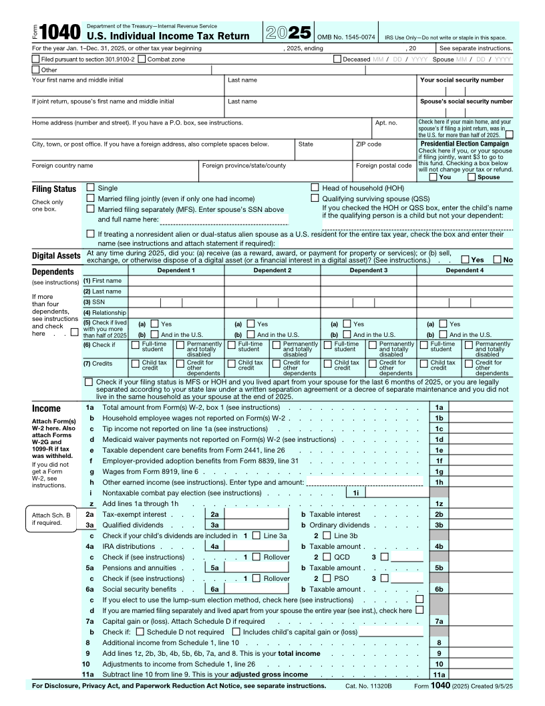

# Python API

`pydoccraft` exposes an eager, PyMuPDF-style API. Opening a document reads the source into memory, invokes the native Rust engine, and returns Python objects that own their extracted text and image bytes.

This page describes the extraction API. Version 0.3.0 also has [native authoring](authoring.md) through `new`, typed content objects and explicit save/copy operations. The [design crosswalk](authoring-api-design.md) and [feature backlog](../TODO.md) describe broader parity work; unchecked items are not implemented promises.

See the [operation evidence matrix](support-matrix.md) for bounded capability profiles, exact test/native references and remaining audit scope. A supported creation or rendering path does not establish imported-document preservation.

## Open a document

```python
import doc_ex

with doc_ex.open("report.pdf") as document:
    print(document.page_count)
    print(document[0].get_text())
```

```python
doc_ex.open(
    path_or_bytes,
    filetype=None,
    password=None,
) -> Document
```

`path_or_bytes` accepts `str`, `pathlib.Path`, `bytes`, `bytearray`, `memoryview`, or a binary stream. Streams are read from their current position, handle short reads and remain open; text streams are rejected. Input is bounded to 128 MiB, including memoryview byte size. Paths are expanded with `Path.expanduser()` and missing paths raise `FileNotFoundError`.

Recognized explicit `filetype` values are:

| Canonical format | Accepted values |
|---|---|
| PDF | `pdf`, `.pdf` |
| Word | `docx`, `.docx`, `word` |
| PowerPoint | `pptx`, `.pptx`, `powerpoint` |
| EPUB (unreleased) | `epub`, `.epub`, `ebook` |

For paths, the suffix is checked against the detected content. For bytes, the native detector identifies PDF, OOXML and EPUB content. A mismatched explicit type raises `UnsupportedFormatError`.

Passwords are supported for encrypted PDF and DOCX input. Encrypted PPTX is rejected by the upstream DeckCraft importer.

## Fast text extraction

```python
text = doc_ex.extract_text("report.pdf")
selected = doc_ex.extract_text("report.pdf", pages=[0, 4, -1])
```

`extract_text(source, *, filetype=None, password=None, pages=None)` returns selected pages separated by form-feed (`\f`) characters. Page indexes preserve caller order, allow duplicates, and support normal negative indexing; invalid indexes raise `IndexError`. Selections are consumed only through a 10,001st-item lookahead and reject more than 10,000 entries; selecting all pages has the same cap. Each format enforces a 64 MiB UTF-8 output limit, including separators. PDF preflights the native glyph string before plain-text assembly; Office uses eager extraction. These are selection/output limits, not a streaming or peak-memory guarantee: upstream parsing and glyph construction happen before the output check.

For PDF, this is a native text-only path: it returns PdfCraft's raw reading-order plain text and skips table/image traversal, media transfer, normalized JSON, and public model hydration. Raw PDF whitespace and table separators can therefore differ from `Page.get_text("text")`, which uses the structured normalized model. DOCX and PPTX use the existing eager extraction model as a compatibility fallback. Every format caps explicit/all-page selections at 10,000 entries and UTF-8 output at 64 MiB. Use `open()` when links, tables, images, geometry, metadata, Markdown, or owned structured values are required.

## Convert a document

```python
pdf = doc_ex.convert(
    "report.docx",
    "pdf",
)

with open("report.pdf", "wb") as output:
    output.write(pdf)
```

```python
doc_ex.convert(
    source,
    output_format,
    *,
    filetype=None,
    password=None,
) -> bytes
```

The supported pairs are PDF→DOCX, DOCX→PDF, and PPTX→PDF. Unsupported and identity pairs raise `UnsupportedFormatError`. See [Formats and fidelity](formats.md) for conversion details.

## `Document`

A document supports context management, iteration, integer indexing, and negative indexing:

```python
with doc_ex.open("slides.pptx") as document:
    assert len(document) == document.page_count
    first = document[0]
    last = document[-1]
    same_first = document.load_page(0)
    for page in document:
        print(page.number)
```

### Properties and methods

| API | Result |
|---|---|
| `document.metadata` | Format and document metadata as `dict` |
| `document.stories` | Owned DOCX auxiliary stories, separate from computed pages |
| `document.page_count` | Number of normalized pages |
| `len(document)` | Same as `page_count` |
| `document[index]` | `Page`; negative indexes are supported |
| `document.load_page(index)` | `Page` |
| `document.to_markdown()` | Markdown for all non-empty pages |
| `document.render_page(index, dpi=144, *, clip=None)` | Rendered page/slide or selected region as PNG `bytes` |
| `document.convert(output_format)` | Converted document `bytes` |
| `document.close()` | Idempotently close the document |
| `document.edit()` | Independent editable PDF; unsupported Office preservation profiles fail explicitly |

Slices are not supported. An out-of-range page raises `IndexError`.

After `close()`, document operations raise `DocumentClosedError`. Previously obtained `Page`, `Block`, `Table`, `Cell`, `Link`, and `Image` data remains readable because extraction is eager. `Page.get_pixmap()` still requires its originating document and therefore fails after that document closes.

## `Page`

`Page.number` is always zero-based. DOCX pages are WordCraft layout pages, PDF pages retain source order, PPTX pages correspond one-to-one with slides, and unreleased EPUB support maps each spine chapter to a page without physical pagination.

### Text

```python
page.get_text()             # plain text
page.get_text("text")       # plain text
page.get_text("markdown")   # conventional Markdown
page.get_text("html")       # semantic HTML fragment (unreleased)
page.get_text("dict")       # structured dictionary
page.get_text("json")       # JSON string
```

An unknown option raises `ValueError`. Plain text preserves table rows using tabs between cells. Markdown emits headings, inline links when exact offsets are known, pipe tables, images, notes, comments, and a final link list for unmatched links.

### Export a page as HTML (unreleased)

```python
from pathlib import Path
import doc_ex

with doc_ex.open("report.docx") as document:
    fragment = document[0].get_text("html")
    Path("page-1.html").write_text(
        "<!doctype html><html lang=\"en\"><meta charset=\"utf-8\">"
        "<title>Extracted page</title><body>" + fragment + "</body></html>",
        encoding="utf-8",
    )
```

The result is an HTML fragment, not a full document. It includes headings,
paragraphs, semantic tables (including nested and merged cells), links with
known text offsets, and embedded image data. Source ordering is retained where
available. It does not reproduce fonts, positioning, or page layout; use
`get_pixmap()` when visual appearance matters. Links without matched text
are available through `get_links()` and are not added to the fragment. Unsafe
link schemes are rendered as text. Images with missing data or unsupported
media types raise `MalformedDocumentError`; excessive content raises
`UnsafeArchiveError`. HTML reflects untrusted input and is not a general-purpose
HTML sanitizer; apply your application's security policy before publishing it.

### Structured content

`get_text("dict")` and `get_text("json")` serialize the extracted snapshot;
they are not an editable document or a round-trip serialization format. No
versioned normalized-output schema or reconstruction API is currently promised.
Fields and metadata vary by format and extraction profile. Treat absent keys,
`None` and empty collections as distinct, and check for optional metadata before
using it. See [coordinates and offsets](coordinates.md) for geometry and range
conventions and [Markdown assets](markdown-assets.md) for the export manifest.


```python
blocks = page.blocks
links = page.get_links()
images = page.get_images()
numbered_images = page.get_images(full=True)
tables = page.find_tables()
```

`get_links()`, `get_images()`, and `find_tables()` return new lists containing the underlying model objects. `get_images(full=True)` returns one-based `(ordinal, Image)` tuples for loose PyMuPDF compatibility.

### Example: inspect structured text and render the same PDF page

This example uses the first page of the [IRS 2025 Form 1040](https://www.irs.gov/pub/irs-prior/f1040--2025.pdf). Download it as `f1040--2025.pdf` and run:

```python
import json
from pathlib import Path
import doc_ex

with doc_ex.open("f1040--2025.pdf") as document:
    page = document[0]
    # Select a few fields from the owned Block objects for a compact display.
    summary = [
        {
            "kind": block.kind,
            "text": block.text.strip(),
            "bbox": [round(value, 1) for value in block.bbox] if block.bbox else None,
        }
        for block in page.blocks[:3]
    ]
    print(json.dumps(summary, indent=2, ensure_ascii=False))
    Path("form-page-1.png").write_bytes(page.get_pixmap(dpi=96))
```

The beginning of the output on this sample is:

```json
[
  {"kind": "paragraph", "text": "1040", "bbox": [43.2, 24.7, 97.1, 48.7]},
  {"kind": "paragraph", "text": "Department of the Treasury—Internal Revenue Service", "bbox": [97.6, 26.5, 245.4, 32.5]},
  {"kind": "paragraph", "text": "U.S. Individual Income Tax Return", "bbox": [97.6, 34.6, 283.8, 46.6]}
]
```

This is a shortened projection of the first three blocks, not the entire page.
`page.get_text("dict")` returns the complete normalized page, including blocks,
links, image metadata, tables and page metadata. Geometry and reading order
come from the PDF engine and can differ across documents; table detection is
conservative. For this example, the form's visible grid is not extracted as a
semantic table. Use `page.find_tables()` to inspect tables that were detected.

The same page rendered at 96 DPI looks like this:



*Source: U.S. Internal Revenue Service, 2025 Form 1040. The illustration is a
PNG rendered from the linked PDF with pydoccraft. Its visual layout is separate
from the extracted structured text above.*

### Rendering

```python
png = document.render_page(page.number, dpi=144)
detail = document.render_page(page.number, dpi=300, clip=(36, 36, 144, 72))
```

`page.get_pixmap()` is a compatibility-oriented alias returning the same encoded PNG bytes; it does not return a PyMuPDF `Pixmap` object. DPI must be finite and between 1 and 1200. PNG physical-resolution metadata records the requested DPI, rounded to integer pixels per meter. Rendering behavior and limits are described in [Formats and fidelity](formats.md) and [Safety](safety.md).

## Data models

All public models are slotted dataclasses and expose `to_dict()`.

### `Block`

```python
Block(
    kind: str,
    text: str = "",
    bbox: tuple[float, float, float, float] | None = None,
    level: int | None = None,
    style: str | None = None,
    links: list[Link] = [],
    images: list[Image] = [],
    table: Table | None = None,
    metadata: dict = {},
)
```

Known block kinds are `paragraph`, `heading`, `table`, `notes`, and `comment`.

DOCX numbered paragraphs carry `metadata["numbering"]` with native `num_id`, nullable `abstract_id`, zero-based `level`, nullable OOXML `format` and parsed `template`. An optional `label` contains the logical native layout label when one unambiguous placement is available. Labels are separate from paragraph text and link offsets; repeated headers with differing labels omit `label`. See [numbering extraction](numbering-extraction.md) for source normalization and page/story limitations.

### `Link`

```python
Link(uri, text="", bbox=None, page=None, metadata={})
```

`metadata` can contain exact Unicode-character `start` and `end` offsets. PDF labels are recovered only when native geometry is unambiguous. Resolved PPTX slide links use `uri="#page=N"` with one-based N and zero-based `metadata["target_page"]`; `link.page` remains the source page. Hidden slides count in normal presentation order. Shape actions retain `metadata["shape"]=True` and do not invent text offsets.

### `Image`

```python
Image(
    name,
    data,
    media_type="application/octet-stream",
    alt="",
    bbox=None,
    page=None,
    metadata={},
)
```

`data` contains owned image bytes. `Image.to_dict()` reports `size` rather than embedding the bytes.

### `Table`

```python
Table(rows, bbox=None, page=None, metadata={}, cells=[])
```

`rows` is the compatible `list[list[str]]` text view. DOCX and PPTX tables additionally provide `cells: list[list[Cell]]`, preserving paragraphs and source merge metadata; DOCX also retains nested tables in source order. Inferred PDF tables leave `cells` empty. `to_dict()` adds the `cells` key only when this structure is available.

Simple `to_markdown()` output treats the first row as the header, pads ragged rows, escapes `|`, and converts cell newlines to `<br>`. Nested, merged, or rich Office tables use escaped HTML tables inside Markdown because pipe tables cannot represent that structure. Plain text uses the flat rows once.

### `Cell`

```python
Cell(blocks=[], col_span=1, row_span=1, covered=False, metadata={})
```

`blocks` contains owned `Block` values; a nested table is available through `block.table`. Span counts are positive, and `covered` identifies a covered source-grid slot (including DOCX vertical-merge continuations and PPTX merge coverage). `metadata["vertical_merge"]` is a DOCX state string (`"none"`, `"restart"`, or `"continue"`) or a PPTX boolean; PPTX also records a `horizontal_merge` boolean. `metadata["grid_column"]` gives the zero-based logical column, including omitted leading DOCX grid cells. WordCraft may insert a required empty paragraph after a nested table, which remains in `blocks`. These extracted values remain usable after the source document closes; changing them does not edit the source document.

## Errors

All native failures are mapped to stable Python exceptions:

| Exception | Meaning |
|---|---|
| `DocExError` | Base error and conversion failures |
| `UnsupportedFormatError` | Unsupported format, conversion pair, or native operation |
| `MalformedDocumentError` | Invalid input, encryption failure, or wrong password |
| `UnsafeArchiveError` | OOXML or native resource-limit violation |
| `DocumentClosedError` | Operation attempted after closing a document |

`ToolNotFoundError` and `ToolExecutionError` remain exported for compatibility with versions before 0.2.0; the in-process engine does not raise them. Ordinary API validation may raise `FileNotFoundError`, `IndexError`, or `ValueError` as described above.

## Auxiliary DOCX stories

`document.stories` is an ordered list of owned `Story(kind, blocks, metadata)` values. Kinds include `header`, `footer`, `footnote`, `endnote`, `comment`, `text_box` and note separators. Blocks reuse existing paragraph/table/link/image values, including nested cell hierarchy. `story.get_text("text" | "markdown" | "dict" | "json")` and `story.to_dict()` expose content without assigning it to an invented page.

Source block order is preserved within each part. Parts use the upstream model's part-ID order, recorded in metadata; original cross-part archive order is unavailable. Each header/footer part occurs once even if rendered on multiple pages. Links/images/table values have `page=None` in stories, and asset source paths include `story_part_id` for identity. Body note references carry `story_refs` offsets and part IDs when exposed by WordCraft.

Body `Document.to_markdown()` retains its existing projection. Comment stories additionally carry `legacy_page_projection=True` because comments remain in the compatibility page output. Callers combining both projections should choose their desired comment scope explicitly. Stories and their model values remain readable after source closure.

## Extraction diagnostics

DOCX/PPTX `document.metadata["diagnostics"]` contains bounded factual notices for constructs observed in the upstream model. Each has `code`, `operation="extract"`, `severity`, `message`, `count` and bounded `sources` locators. Examples distinguish omitted chart data, linearized equations, omitted ruby annotations, cached dirty fields, preview-only embedded objects, unsupported PPTX actions and approximate transformed geometry. Counts remain exact when source examples reach the 100-example total limit.

Inspect notices before relying on extracted content:

```python
with doc_ex.open("report.docx") as document:
    for notice in document.metadata.get("diagnostics", []):
        print(notice["code"], notice["count"], notice["message"])
    text = document.to_markdown()
```

A missing or empty diagnostics list does not establish completeness. Applications
can decide which known codes need review; do not assume future versions cannot
introduce additional codes. These notices describe semantic extraction only. They do not claim that rendering/export is correct, that all unsupported source markup is detectable, or that a document is safe for lossless editing. Parser, encryption, conversion and resource failures remain errors; a notice never replaces them. Native normalized JSON output stops at 64 MiB before its output buffer exceeds that budget.

## Portable Markdown

`document.export_markdown()` returns an owned `dict[str, bytes]` containing body/story Markdown, deduplicated local media and a JSON placement manifest. It reuses existing formatting and leaves `to_markdown()` compatible. See [portable Markdown and media](markdown-assets.md) for the schema, bounds and nested-table behavior.


## DOCX source paths and line layout

Paragraph and table metadata use `source_path`; paragraphs and their assets also use `segment`, the zero-based explicit page/column-break segment. Paths identify native model blocks: `[block]`, followed by `[row, physical_cell, block]` for each table nesting. Body values use the absence of auxiliary story keys to identify the Body story; no duplicate body tag is added. Auxiliary metadata uses existing `story_part_id` or separator story-kind/role keys. Identity belongs to this extracted snapshot; paths are not XML paths, file offsets or durable IDs across edits/reparse. Legacy aggregate page comments have no invented paragraph path.

`Page.metadata` additionally exposes native `body_bbox`, zero-based `section` and `display_number`; existing `width` and `height` remain in points. The body box describes a layout frame.

Supported Body paragraphs, including native indexed table-cell placements, have `block.metadata["layout"]`:

```python
{
    "coordinate_space": "page-points",
    "offset_space": "paragraph-utf8",
    "geometry": "native-selection",
    "lines": [
        {"page": 0, "source_range": [0, 19], "rects": [[36, 36, 130, 50]]}
    ],
}
```

The example illustrates the shape, not fixed geometry. Each half-open source range refers to the native paragraph's UTF-8 bytes, including inline-object placeholder bytes; it is **not an offset into `block.text`**. Page/column-break tokens are excluded from their adjacent explicit segment ranges. Ordered line records retain actual pages and repeated table-header occurrences. Whole automatically split paragraph text still appears once on its first assigned page; later line records do not invent normalized page text slices.

Rectangles are native logical selection extents. They can extend outside paint clipping and do not include every object, list label, drop cap or visible glyph overhang. Empty rectangles can accompany valid zero-width source evidence. Condensed text can have finite signed cluster advances. The projection follows native positive-span behavior and preserves source line records; it does not turn advances into glyph-ink bounds. Missing layout means this projection is unavailable: auxiliary stories and nested native Clip placements are not inferred. `Block.bbox`/`Table.bbox` remain `None` for DOCX; no union box is invented for multi-page/disjoint content. Existing extracted values and metadata are mutable owned snapshots and remain readable after closure; changing them does not change native document content.

Additional extraction limits are 100,000 line observations, 200,000 rectangles, 8,000,000 conservative native work units and 128 MiB conservative retained-provenance allocation allowance, including copied output representations. The allocation allowance can bind well before the count caps: the measured 200-page synthetic report charges 132,081,792 bytes, close to 128 MiB. This is not a general 200-page guarantee. A separate 16 MiB conservative native temporary-memory allowance bounds selection buffers/sort scratch. Limits fail with `UnsafeArchiveError`; malformed native geometry fails with `MalformedDocumentError`. The existing 64 MiB normalized JSON boundary still applies.


Owned DOCX style collections also support `del document.styles[name_or_id]` and integer-index deletion of one unused custom definition. Deleted handles stay invalid; builtin/default and referenced definitions refuse deletion. The 1024 lifetime named-ID budget includes builtin and retired IDs. See [unused-style deletion](authoring.md#delete-an-unused-docx-style) for ownership, callback and capacity behavior. No batch/import API is implied.


Existing paragraph/table/row layout values retain concrete Python types for IDEs and static consumers: spacing is a three-float tuple, column widths a list, uniform borders a nullable color/width tuple, and row height a tuple containing a nullable height plus its rule. Assignments retain accepted tuple/list inputs and iterable column widths. These annotations do not broaden format capabilities; PPTX row height still requires `at_least`, and DOCX-only row flags retain their explicit refusal.
